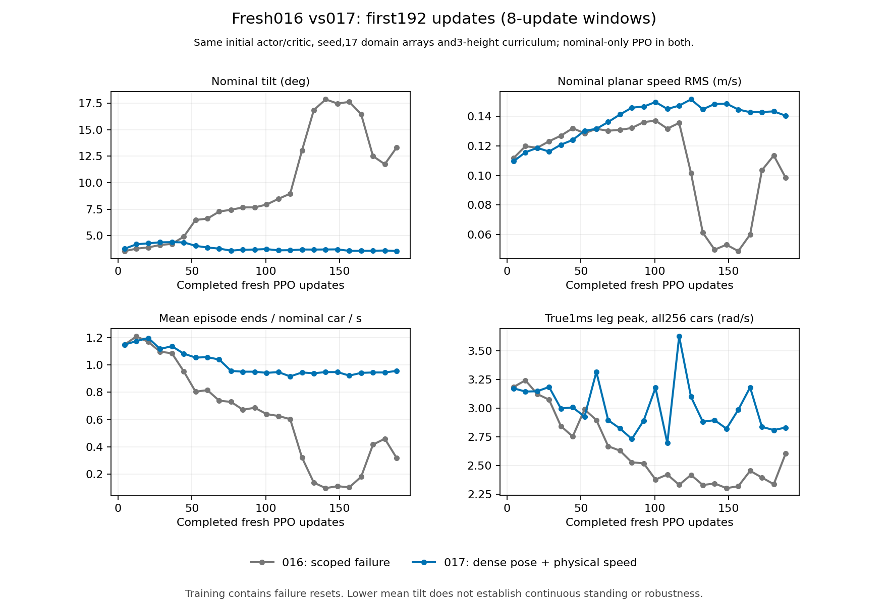
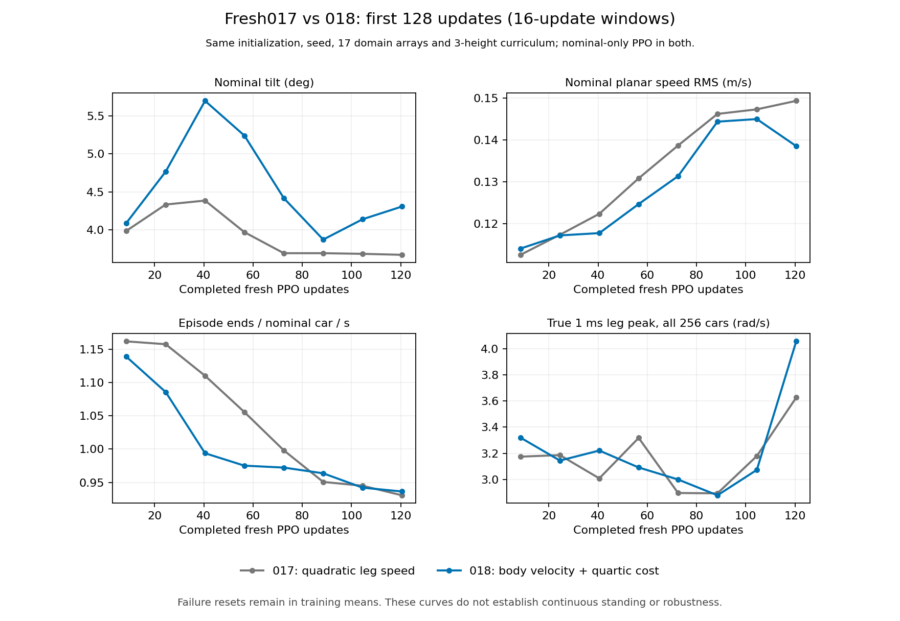
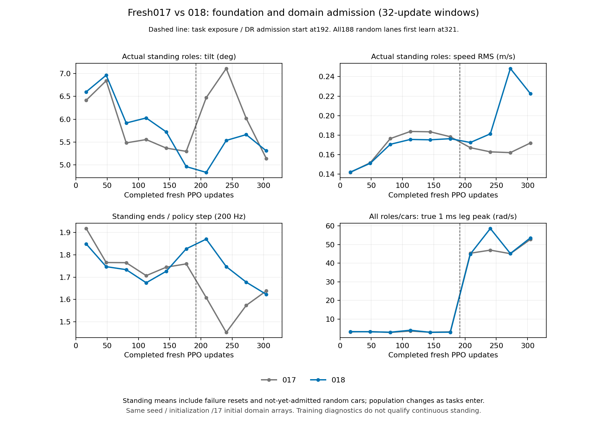

# 轮腿策略能力盘点：2026-10-27

当前没有同时通过长期13项要求的一代，也没有可据此部署实车的高鲁棒策略。016从零试训因静站失败和动态高速在330更新正常停止，017新增稠密姿态/主动腿速成本后从零运行456更新正常封存，完整名义冷测仍失败；018已从零运行至387/1536更新，321起全部188随机车参与学习，最新纯静站速度RMS0.16647m/s，真实腿速峰74.414rad/s，尚无行为通过；已结束的新策略中，013仅提供中高度短时站立的部分证据。各代成绩分开，不能拼成一个合格策略。

长期要求仍见 [WHEEL_LEG_ACCEPTANCE.md](WHEEL_LEG_ACCEPTANCE.md) 和 [v2合同](../contracts/wheel_leg_acceptance_requirements_v2.json)。[10月26日盘点](WHEEL_LEG_CAPABILITY_STATUS_20261026.md)保留009及历史115/121的原始结果。本页更新当前证据，未修改旧轨迹、判定或TensorBoard event。

## 用户指定的随机化已落实

训练使用 [随机化v2合同](../contracts/wheel_leg_randomization_study_v2.json)：腿P、腿D、气弹簧系数均固定1；独立惯量比例0.94–1.06；IMU固定roll/pitch偏角±0.8°、yaw±0.266667°，为旧停止阶段的1/3；IMU晃动幅度为0。其余旧停止阶段范围保留，没有叠加旧gap覆盖。

电机强度0.84–1.16、质量0.92–1.08、COM前后±12mm/左右±6.4mm/上下±8mm、地面摩擦0.3–0.5、策略观测0/5ms延迟及原噪声/编码器偏置保留。P/D独立比例固定，不意味着乘上电机强度后的有效未饱和P/D完全无变化。训练保留25%名义复习；地面摩擦独立抽样，也覆盖名义mask车。这些仍是研究范围，尚未由实车辨识确认包络，物理PD编码器白噪声覆盖也未获得验证。

独立惯量的±6%乘在质量缩放之后，实际刚体惯量张量总比例为0.8648–1.1448；不是相对名义张量仅±6%。这沿用旧质量与惯量的组合方式，没有额外缩窄保留的质量范围。

## 013：中高度8秒基础恢复，不是全项通过

013完整结束512次从零更新，actor/critic/Adam均独立初始化。最终PT SHA为 `89797305c6c4eba5e1cb8f11a2c055b56a3ae29fe43f3aa3fc67117721cf69ba`。以下均是这个准确权重、seed261201、200Hz策略/1kHz物理的冷启动8秒评测，不含暖场最佳值。

| 305mm冷测 | 名义配置 | 指定域配置全部7台 | 其中实际随机化的6台 |
|---|---:|---:|---:|
| 旧8秒基础条件及v2接地通过 | 7/7 | 7/7 | 6/6 |
| 同时满足既定最大XY≤5cm | 7/7 | **5/7** | **4/6** |
| 最大XY偏移 | 1.709cm | 5.619cm | 5.619cm |
| 忽略≤2ms后保留失载 | 0ms | 0ms | 0ms |
| 最长原始失载 | 2ms | 2ms | 2ms |
| 完整30秒静站验收 | 未测 | 未测 | 未测 |

指定域原配置保留25%名义mask，实际本组为6随机+1名义，不能写成7个独立随机样本全部通过。旧 `standing_pass_v2` 是8秒基础条件加修订接地的标签，没有把既有XY限制计入；加入XY后的5/7为同一原轨迹重算，不能仍简称完整静站7/7。230/420mm各0/7，均未训练该高度，不能从305mm外推。

来源：[冷测封存](../reports/robust_policy_repair_20261024/domain_admission_cold_comparison001.json)、[逐case范围复核](../reports/robust_policy_repair_20261024/fresh_capability_scope_read001.json)。本次新增138个范围/位移计数标量通过原RSL Logger写入独立TensorBoard event并全部读回；0新仿真步、0PPO、没有构造优化器。约0.0036°的微小振动和≤2ms短脉冲仍按用户要求处理，没有重新收紧标准。

## 当前13项能力逐项状态

以下013列只评价上述同一准确权重。017列为456更新停止权重、seed271301、名义域198场30秒冷测的修复汇总；不足原1536更新终点，不能代替最终策略。两个replica在名义域含重复初态，不是独立随机种子。所有13项均已测，均未达到完整工程通过。

| 编号 | 能力 | 已结束013证据 | 017（456停止） |
|---|---|---|---|
| R01 | 初始前后/侧倒/完全倒扣自起 | 未训练、未测 | 48场，原生自起完成0/48 |
| R02 | 运动中真正翻倒后快速恢复原命令 | 未训练、未测 | 24场完整通过0/24，4场原生护栏 |
| S01 | 三高度静站、接地、漂移 | 仅305mm短时部分通过；低/高各0/7；无30秒结果 | 42场完整通过0/42；30秒原始数据已测 |
| M01 | 近零低速前进/后退、直线 | 未训练、未测 | 已测，完整通过0 |
| M02 | 高速正反直线及速度跟随 | 未训练、未测 | 已测，完整通过0 |
| M03 | 顺逆时针80–100rpm原地小陀螺 | 未训练、未测 | 24场完整通过0；未达到80rpm |
| M04 | 正反速度配合左右转弯四象限 | 未训练、未测 | 已测，完整通过0 |
| H01 | 静止低中高双向升降 | 未训练、未测，固定高度保持不能替代 | 已测，完整通过0 |
| H02 | 运动中变高及同步速度/yaw/路径 | 未训练、未测 | 已测，完整通过0 |
| H03 | 两方向高速自旋中变高 | 未训练、未测 | 已测，完整通过0 |
| B01 | 高速正反直接给零的急刹 | 未训练、未测 | 已测，完整通过0 |
| Q01 | 全任务平顺、真峰值、力矩及腿轮协调 | 只有305mm短时静站分项，不能代表动态流畅 | 198场均已记录真实腿速/力矩/轮心协调；未通过 |
| D01 | 名义/单组/组合域与独立种子鲁棒性 | 1种子8秒组合域中高度4/6满足基础及XY；其他高度失败 | 名义已失败；同PT前2秒指定域放大腿速，不授鲁棒资格 |

髋膝改变轮心相对车体前后位置、与轮速共同完成平衡/加减速的要求保留。当前动作仍为四腿位置与两轮速度，并记录虚拟腿、轮心、pitch、接触/滑移；有输出和观察器不证明已学会有效协调。RMCS倒扣查表作为姿态覆盖参考，不引入脚本/FSM代替六轴闭环RL自起。

## 017已封存：姿态退化受抑制，静站未学稳

017原PID915858/start4794969在456更新完整保存后正常退出，274份源/归档及017b队列12份源通过停止封存，模型/优化器/RNG有限，18项Adam均为5472步。停止PT SHA`76a4d00a0028163d62330f2fc7c8faab80a7a9f1c6c639236af6b48e48d82556`，仅供只读诊断，不续训或当teacher。提交`06f0d49a`，原1536有界试训未完成；256环境×128策略步、200Hz策略/1kHz物理/PD160/2.5、求解器64/32。actor、critic、空Adam从零初始化，初始网络及17项实际域抽样与016逐项一致，首更新31项独立检查通过，无旧权重读取。

与016相比只加两项训练奖励：纯静站直立出生的稠密姿态成本，以及所有主动控制任务逐5个真实1ms样本计算的腿速成本`0.2*mean((dq/5)^2)`。被动、已结束车和固定评测不付新增成本。没有改动作、PD、域宽度或保护；腿速成本不是控制器硬限速。28项CPU目标检查及另2项身份检查通过；原生005的17项接线检查/RSL标量读回通过，0PPO，逻辑恢复正对照出生直立，不能称倒地自起成功。

以下是原TensorBoard中名义组的互不重叠32更新窗口。前192只让68名义车参与PPO/归一化，188随机车已用完整指定物理范围仿真：

| 更新窗 | 017倾角均值 | 016同期倾角 | 017高度MAE | 017速度RMS | 017结束次数/车/秒 |
|---|---:|---:|---:|---:|---:|
| 1–32 | 4.160° | 3.841° | 1.948mm | 0.1150m/s | 1.160 |
| 33–64 | 4.178° | 5.562° | 1.955mm | 0.1266m/s | 1.083 |
| 65–96 | 3.693° | 7.517° | 1.546mm | 0.1425m/s | 0.974 |
| 97–128 | 3.678° | 9.605° | 1.679mm | 0.1483m/s | 0.938 |
| 129–160 | 3.674° | 未在此表复列 | 1.650mm | 0.1466m/s | 0.939 |
| 161–192 | 3.585° | 未在此表复列 | 1.521mm | 0.1424m/s | 0.947 |

姿态均值比016同期低，但仍频繁失败重置、速度未收敛，不能称为稳定站立。全量随机学习人口在320更新达到；192后名义人口混有运动/恢复任务，名义均值不能替代纯静站。以下使用原`FreshTasks/standing/*`角色标签，包含当时全部实际静站车：

| 更新窗 | 平均静站车数 | 倾角均值 | 高度MAE | 速度RMS | 结束次数/策略步 |
|---|---:|---:|---:|---:|---:|
| 161–192 | 256.00 | 5.297° | 2.695mm | 0.1783m/s | 1.7595 |
| 193–224 | 254.84 | 6.471° | 3.562mm | 0.1671m/s | 1.6082 |
| 225–256 | 246.25 | 7.109° | 4.041mm | 0.1628m/s | 1.4521 |
| 257–288 | 234.66 | 6.017° | 3.236mm | 0.1620m/s | 1.5735 |
| 289–320 | 224.90 | 5.143° | 2.434mm | 0.1719m/s | 1.6382 |
| 321–352 | 214.03 | 5.007° | 2.374mm | 0.1744m/s | 1.5730 |
| 353–384 | 202.71 | 4.906° | 2.237mm | 0.1774m/s | 1.5068 |
| 385–416 | 192.58 | 4.765° | 2.078mm | 0.1794m/s | 1.4299 |
| 417–448 | 181.13 | 4.732° | 2.040mm | 0.1817m/s | 1.3496 |

456更新的全局真实1ms腿速峰**71.459rad/s**，≥50样本**229个**。早196更新的3.626rad/s只覆盖基础阶段，已不能代表完整训练。当前训练极值没有同步车号/控制阶段/实际力矩，不能用旧016的事件直接解释这些样本；新完整评测已补充这些字段。13项冷测、30秒接地/漂移均未通过。

历史013中高度到225–256才明显收敛，但017三高度、种子、回合协议不同，只作学习时间参考，没有以旧权重/梯度指导017。来源：[456停止封存](../reports/robust_policy_repair_20261024/fresh_unified017_stopped_closure001.json)、[017首更新核验](../reports/robust_policy_repair_20261024/fresh_unified017_first_verified001.json)、[历史013原RSL时间线](../reports/robust_policy_repair_20261024/historical013_learning_timeline001.json)。

下图只画前192次原RSL字节前缀，SHA核验并目视检查；前三图为名义组，真腿速峰图为全部256台。图的范围不覆盖192之后的混采阶段：

## 已退役016与高速腿动的来源

016因静站失败在330次更新正常停止，原训练/GPU已退出，273份训练源及旧队列12份源封存保持；18项Adam步数3960、完整状态/RNG有限。停止PT SHA`7cc58df3231632983b6e4cd432b98df715536e9e66a9186f92829f5d52cc3cd9`。真极值330次齐全、普通RSL329次，最后一次在完整优化/保存后、普通logger前正常停止，消费不抹除。全程峰50.9667rad/s，7个真实1ms电机样本≥50rad/s。289–320纯静站组倾角18.374°/高度MAE12.516mm，不能当合格策略。来源：[停止封存](../reports/robust_policy_repair_20261024/fresh_unified016_stopped_closure001.json)。

用同一停止PT、独立固定种子271301做198场首2秒诊断，两次原生进程均退出，各108项RSL测量读回、源/权重/轨迹SHA保持，0PPO：

| 真实1ms腿速峰 | 名义域 | 指定域 |
|---|---:|---:|
| 六轴零力矩被动落稳 | 35.469rad/s | 36.534rad/s |
| 主动恢复 | 46.919rad/s | 69.320rad/s |
| 普通主动控制 | 13.310rad/s | 15.593rad/s |

被动峰处实际电机力矩全0；指定域主动峰发生在后倒对称自起，右膝-69.320rad/s时电机为+35.757N·m，正在反向制动。速度值不是策略直接命令69rad/s的证据，也不是原训练50.967事件的准确重放。名义/指定域48个初始自起案例中分别42/43个在被动阶段已超过原15rad/s工程预警，主动阶段两域均48个超过。旧零力矩落稳为0.2–1.2s，这段RL无控制权；原预警和样本继续保留，不由奖励修复或阈值删除掩盖。来源：[分阶段比较](../reports/robust_policy_repair_20261024/fresh016_native_peak_comparison001.json)、[被动初始化复核](../reports/robust_policy_repair_20261024/passive_startup_review001.json)。

三个落稳时钟缩为5ms的独立候选已经完成017停止后的原生对照，主动峰和冲击终止增加，已拒绝采纳；详见下方启动对照。018保留原启动，未改当前训练的动作、物理保护或随机化宽度。来源：[候选配置](../reports/robust_policy_repair_20261024/short_passive_activation_prepared001.json)、[原生配对](../reports/robust_policy_repair_20261024/fresh017_peak_startup_comparison001.json)。

## 腿驱动模型仍有未辨识缺口

017实际原生读回确认：四腿的附加armature、原生库仑摩擦和黏滞阻尼均为0；连杆刚体惯量并不为0。当前只有40N·m恒定力矩上限，没有已辨识腿驱动响应/扭矩—转速包络；独立刚体惯量±6%不等于覆盖了这些驱动不确定性。既有9月腿侧候选只在悬空、近伸展窄域改善，宽域回放仍失败，不作为全域真实参数采纳。

厂家2025手册第17页列DM-J8009-2EC空载168rpm@24V、335rpm@48V，即17.593/35.081rad/s；页面两张曲线为固定100rpm负载测试，不能据此拟造完整四象限驱动曲线。实车电压尚待确认。空载转速不是外力反拖硬上限；同一016指定域2秒原生轨迹63个≥50样本中，同向做功39、反向制动24。更广的≥35.081样本中，名义主动恢复同向做功744/制动256，指定域同向654/制动196。恒定力矩假设允许高速持续正功，暴露了模型缺口；既不是实车超速证明，也没有确认其为017全部问题的唯一原因。没有限速钳位、伪造电机参数或修改当前训练。来源：[只读模型/逐1ms功率复核](../reports/robust_policy_repair_20261024/leg_motor_model_gap_audit001.json)、[既有腿模型审计](V6_RESPONSE_LEG_AUDIT_20260929.md)、[厂家2025手册](https://www.worldrobotconference.com/profile/robot/download/2025/06/30/%E8%BE%BE%E5%A6%99%E7%A7%91%E6%8A%80DAMIAO%20-%202025%E5%B9%B4%E4%BA%A7%E5%93%81%E9%80%89%E5%9E%8B%E6%89%8B%E5%86%8C_20250630192546A441.pdf)。

## 后续验收与部署状态

017b队列先仅接收一次SIGTERM并正常退出，0评测步/无子进程；随后原训练仅接收一次SIGTERM，在456完整更新后保存停止PT并退出。真极值记录456更新，普通RSL455更新，最后完整优化和保存早于停止异常/普通logger；没有减记消费。累计实际消费5068，其中完整结束试训4225、停止试训842、失败1。原192–320域人口渐入已完成，但未到768全部任务常驻，也未运行792场完整评测。来源：[队列关闭](../reports/robust_policy_repair_20261024/fresh_full_suite_queue017b_stopped_closure001.json)、[训练封存](../reports/robust_policy_repair_20261024/fresh_unified017_stopped_closure001.json)。

018已全新初始化并开始有界试训，新增成本和同样本峰值接线经原生006验证后采纳，当前仍未取得行为通过。完整验收要求准确同一最终PT，两种子×名义/实际全随机×198场=792；站立等30秒、高速直线18秒、原始数组和实际35D→6D均值保持，不以停止权重替代完整终点。5ms被动初始化候选已由独立原生对照拒绝。来源：[原生接线](../reports/robust_policy_repair_20261024/fresh_unified_native006_verified.json)、[018首更新](../reports/robust_policy_repair_20261024/fresh_unified018_first_verified001.json)。

正式长训、ONNX及RMCS集成尚未获得行为准入。所读RMCS旧配置为50Hz、yaw上限4rad/s（约38.2rpm），与当前200Hz/100rpm请求存在接口差异；以后必须绑定准确PT、内嵌归一化/高度系数/轮速增量和实际动作边界，保留遥控、CAN/IMU、失效推理停止及相对角力矩保护。尚未导出候选、改动RMCS或运行实车。详细过程见[退化诊断](WHEEL_LEG_DR_REGRESSION_20261027.md)。

## 017停止权重的完整冷测诊断

同一停止PT、seed271301、名义v2配置、198场、原200Hz/1kHz与64/32；所有6000策略步完成，176场跑满各自声明时间，22场被原生护栏终止。13类均无完整工程通过，48初始倒地场无原生自起完成；这不是完全训练1536更新后的结论。名义域两replica重复初态，不能当独立种子。原始评分在float32时钟检查中断，经CPU修复后使用原轨迹；另一次同种子原生重置提供初始参考，全部10个公共字段的完整2秒前缀逐元素相同。原receipt/event/轨迹均不覆盖，新269个RSL汇总标量已读回。

| 直接直立出生、零pitch、30秒 | 230mm | 305mm | 420mm |
|---|---:|---:|---:|
| 最大倾角 | 23.267° | 33.997° | 52.513° |
| 最大XY偏移 | 5.966cm | 142.135cm | 27.059cm |
| 忽略每段≤2ms后保留失载 | 0ms | 52ms | 503ms |
| 最长原始失载 | 1ms | 6ms | 104ms |
| 真实1ms腿速峰 | 2.012rad/s | 3.016rad/s | 3.903rad/s |

230mm的有效接地通过不能代替姿态/漂移通过；中高位也存在超过2ms的失载。不能用安静但倾斜的最终状态声称站稳。顺逆自旋24场按请求方向投影的实际平均转速约−20.917到0.003rpm，存在反向转动；未到最低80rpm。急刹原生案例没有先达到要求高速，不能用最终停住算高速刹车成功。

同PT/198场前2秒：名义被动/主动恢复/普通控制峰35.469/46.951/7.597rad/s；指定域36.534/71.070/11.300，主动恢复≥50样本63、冲击终止2场。缩短被动至5ms的名义配对使主动峰升58.301、≥50样本200、冲击终止10，拒绝采纳；启动使能同时改变原护栏的阶段归属，护栏数本身不单独证明冲击增大。保留原启动与保护。

来源：[完整评分修复](../reports/robust_policy_repair_20261024/fresh017_full_native_nominal001_scoring_repair001.json)、[启动/域对照](../reports/robust_policy_repair_20261024/fresh017_peak_startup_comparison001.json)。018仅改变训练目标：新增纯静站稠密速度成本、主动腿速四次成本，同样本峰值RSL记录；全部其他任务设置与017一致，域范围不缩窄。原生006的19项接线与RSL检查通过、0PPO，接线验证不授予行为资格。

## 018从零试训已实际启动，保持指定随机化

原PID1079271/start5655760，1536更新有界试训、256环境×128策略步，200Hz/1kHz、PD160/2.5和64/32保持。训练源提交`dafaf894`，274份归档源固定。首5更新的32项独立核验通过：全新actor/critic/空Adam，初始张量与017一致，无旧PT读取，首12次Adam调用实际改变10/8参数张量；原始17组域数组与017相同，首PPO仅68名义车，188指定域车已完整物理仿真。新增8个目标RSL指标、11个同1ms峰值见证指标和跨推理模式清零已真实读回。

前15更新峰3.319rad/s（更新2、227号车、左膝（策略轴1）、普通静站阶段，同样本实际−4.145N·m/−13.758W，处于制动），尚无≥50样本；这只覆盖基础阶段，不能外推恢复/动态速度。1–8更新名义倾角3.930°、速度RMS0.1100m/s，与017同期3.778°/0.1096m/s相近，尚无改善结论。训练含失败重置，不能把均值称30秒稳定。人口/任务计划与017保持192基础、320全域PPO、768全技能。

评测队列PID1083123/start见回执，已冻结12份源，等待准确1536终点及训练/GPU退出，再串行两种子271301/271401×名义/全随机域，各198场共792场。当前0原生评测；不会恢复失败/停止PT或启动重复训练。来源：[018首PPO](../reports/robust_policy_repair_20261024/fresh_unified018_first_verified001.json)、[前15更新观察](../reports/robust_policy_repair_20261024/fresh_unified018_first8_001.json)、[评测队列](../reports/robust_policy_repair_20261024/fresh_full_suite_queue018_launch001.json)。

018首32更新窗（观察时33完成）：名义倾角4.428°、速度RMS0.11568m/s、高度MAE2.150mm、结束约1.112次/名义车/秒；017同期4.160°/0.11504m/s/1.948mm/1.160次。全256静站为6.598°/0.14204m/s/3.647mm，含尚未参与PPO的指定域车；不能混淆这两个人口。新目标初期未见确定改善，继续观察，不热改。全局真实峰仍3.319rad/s（更新2普通控制的制动样本）、≥50为0。274+12源及身份/域时钟保持。来源`fresh_unified018_first32_002.json`；曲线只取原RSL event SHA固定前缀。

### 018前128更新：名义静站尚未收敛

观察时完成129更新，仍在前192基础阶段。68名义车参与PPO与归一化，188随机车按完整指定范围实际仿真、尚未参与学习；因此这段名义失败不能归因为随机车梯度或归一化统计的污染。尚不能由此单独排除共享地面摩擦、网络/目标/探索/时钟等其他因素。

| 更新窗 | 018名义倾角 | 017同期倾角 | 018名义速度RMS | 017同期速度RMS | 018结束次数/名义车/秒 |
|---|---:|---:|---:|---:|---:|
| 1–32 | 4.428° | 4.160° | 0.11568m/s | 0.11502m/s | 1.112 |
| 33–64 | 5.471° | 4.178° | 0.12127m/s | 0.12664m/s | 0.984 |
| 65–96 | 4.145° | 3.693° | 0.13789m/s | 0.14246m/s | 0.968 |
| 97–128 | 4.224° | 3.678° | 0.14178m/s | 0.14833m/s | 0.939 |

速度略低而倾角较高，不能概括为稳定性改善。97–128全256纯静站均值6.028°/0.17556m/s/3.300mm；188未参与学习随机车6.680°/0.18590m/s/3.747mm，与名义人口分开。所有训练均值包含失败后的重置，不能当30秒持续站立或漂移验收。

前129次真实1ms腿速峰4.056rad/s，更新119、61号车、右膝（策略轴3）、普通静站，配对实际+7.400N·m/−30.019W，属于制动；≥50样本为0。尚未进入倒地恢复/动态课程，不能据此称已解决其高速腿动。当前源274份、队列12份、准确PID/GPU与域准入时钟均保持，无旧权重读取。下一观察重点为192之后的随机域学习渐入；当前不热改或重启训练。

来源：[64更新窗](../reports/robust_policy_repair_20261024/fresh_unified018_live64_003.json)、[96更新窗](../reports/robust_policy_repair_20261024/fresh_unified018_live96_004.json)、[128更新窗](../reports/robust_policy_repair_20261024/fresh_unified018_live128_005.json)。下图仅从两代原RSL event的SHA固定字节前缀导出：

当前资产/重置库的额外CPU静态核查：三高度名义总质心X均与轮心平均X对齐，残差最大2.67e−12m，闭链最大1.48e−13m，未发现明显的名义重置前后失衡。19刚体质量各自取范围端点，共524288组合，并对base COM偏置取极值；独立分式界限计算交叉核对后，低/中/高位静态COM偏移界限分别为[−11.416,+11.660]/[−11.313,+11.565]/[−10.927,+11.209]mm。这量化保留的质量/COM扰动，不是退化根因、动态可控性或硬件包络证明；惯量不影响该静态COM计算。0新原生/0PPO，不读取策略、不改训练。来源：[静态支撑核查](../reports/robust_policy_repair_20261024/fresh018_reset_support_audit001.json)。

### 从零actor的ONNX数值路径已补齐，行为资格仍未取得

旧`export_unified_getup.py`要求带冻结旧父策略的checkpoint，不能用来导出当前从零actor。新增[数值检查工具](../scripts/verify_fresh_export_parity.py)从准确PT的归档源构造actor，不构造PPO或优化器；当前显式支持可训练三高度、腿速分离和轮速增量这一种ABI。导出固定float32 `[1,35]`→`[1,6]`未裁剪确定性均值，完整包含一次经验归一化、训练后的高度系数和轮速增量；不附加`rmcs_obs_mean/std`导致二次归一化。

只用已失败的017停止PT及原198场30秒记录验证工具：300个策略时刻、54535组有效原生输入/均值，CPU actor对原GPU最大绝对差1.907e−6，导出模块对CPU为0，实际ONNX Runtime对原GPU最大3.815e−6（原始动作单位，数值容差5e−5）。漏掉包装逻辑、重复归一化的负对照差约8.985和172.869，输入集合能识别这些错误；checkpoint引用错、原生均值改动、NaN观测三个破坏性对照全部拒绝且未创建输出。8项原RSL Logger数值指标已读回，0新原生/0PPO，原PT/观测文件保持。

诊断图仅保存在主目录`reports/robust_policy_repair_20261024/fresh017_export_diagnostic001/diagnostic_mean.onnx`，带诊断/未获行为资格元数据；没有安装或修改RMCS配置。原017旧receipt没有在评分异常前落下parity文件SHA，本次另存该文件当前SHA和全量数值重算证据，不冒称历史receipt已完整。该数值通过不能改变017的13项行为失败，也不能代替未来最终同PT的完整评测、正式长训或部署协议对齐。来源：[封存与负对照](../reports/robust_policy_repair_20261024/fresh017_export_diagnostic001_verified.json)。

### 018开始随机域学习：出现名义域恢复高速，尚未控制住

193更新观察的161–192基础窗：68名义车倾角3.548°、高度MAE1.519mm、速度RMS0.13954m/s、结束约0.971次/车/秒；基础末端仍未站稳。随后193–224的纯静站标签含平均254.58台实际静站车，为4.838°/2.382mm/0.17243m/s、结束1.8706次/策略步；同期017纯静站6.471°/3.562mm/0.1671m/s。018姿态较好、速度反而略高、失败重置仍频繁，不能算总体稳定或鲁棒性通过。此阶段名义人口已混入其他任务，0.13694m/s的名义人口均值不再当作纯静站结果。

230更新观察全局真实1ms峰**58.554rad/s**，≥50样本**45个**：更新230、66号车、右髋（策略轴2）、初始自起任务的主动恢复阶段，出生物理时间约0.907s，配对实际−30.750N·m/−1800.537W，处于制动。66号车是**名义域mask且已参与PPO/归一化**，该更新随机学习人口54台。因此严重高速不能全部归因于随机化幅度过高或该车尚未纳入学习；地面摩擦在名义车上仍独立抽样。新四次成本尚未控制住动态峰值，不再引用基础阶段4.056rad/s作为当前全局峰。

此前206更新44.864rad/s是另一个事件：64号随机车、左髋、主动恢复、同向+16.186N·m/+726.161W；该车当时尚未纳入PPO/归一化，要到第307更新才进入。205同车被动初始化峰25.834rad/s、电机实际力矩0。归档代码重建mask与实际RSL准入数一致；不能把206的未学习样本和230的已学习名义样本混为同一原因。每更新只记录其最大样本的阶段，不能由这些行反推全部≥50样本的分阶段计数。

前192全部256台的新增静站失败事件均值1.7555次/策略步，其中倾角越20°为1.6766、高度误差越25mm为0.2338，两类可重叠；这些是含未学习随机车的全人口统计，不能冒称68名义车的分项。当前274份训练源和12份队列源保持，仍从零原进程持续；320次完成后下一个更新开始全188随机人口参与。尚无018最终同PT冷测或部署资格。

来源：[192基础窗](../reports/robust_policy_repair_20261024/fresh_unified018_live192_006.json)、[210更新观察](../reports/robust_policy_repair_20261024/fresh_unified018_domain_entry208_007.json)、[230更新观察](../reports/robust_policy_repair_20261024/fresh_unified018_live224_008.json)、[206峰准入重建](../reports/robust_policy_repair_20261024/fresh018_peak_admission_read001.json)、[230峰准入重建](../reports/robust_policy_repair_20261024/fresh018_peak230_admission001.json)。

### 018完成域准入渐进：新增成本尚未改善静站

323更新时，274份训练源和12份等待评测源、原PID/startticks/GPU及逐更新准入时钟均核验保持。第321更新起68名义+188随机车全部参与PPO及归一化；任务种类仍按原192–768计划渐入。以下仅取真实纯静站角色标签，包含尚未准入的随机车及失败重置，人口随其他任务加入而减少；不是完整名义人口的结果或无重置站立验收。

| 更新窗 | 018平均静站车数 | 018倾角均值 | 018高度MAE | 018速度RMS | 017同期速度RMS |
|---|---:|---:|---:|---:|---:|
| 193–224 | 254.58 | 4.838° | 2.382mm | 0.17243m/s | 0.16710m/s |
| 225–256 | 245.80 | 5.536° | 2.988mm | 0.18132m/s | 0.16283m/s |
| 257–288 | 234.32 | 5.664° | 3.089mm | **0.24837m/s** | 0.16204m/s |
| 289–320 | 224.24 | 5.309° | 2.705mm | **0.22265m/s** | 0.17191m/s |

新增速度/四次腿速成本未在这些训练窗口形成稳定收益；速度RMS反而恶化。RMS无法区分少数离群车与普遍漂移，不能从此反推每台车的漂移或接地。289–320静站结束1.6228次/策略步，仍频繁重置。全323更新真实峰仍58.554rad/s，累计≥50rad/s样本75个；原230名义恢复峰的归属保持，不把每rollout最大见证当所有高速样本的阶段计数。无018最终冷测、13项通过或部署资格。

仅从两份SHA核验的原RSL event字节前缀导出下图，全部静站窗口均与既有观察报告逐值相同，0新原生/0PPO，无本机TensorBoard服务。历史共同编码器零偏的0/7负结果仍保留于退化报告；本轮未将该已测建模差异重新认作唯一根因或热改当前训练。

来源：[256观察](../reports/robust_policy_repair_20261024/fresh_unified018_live256_009.json)、[288观察](../reports/robust_policy_repair_20261024/fresh_unified018_live288_010.json)、[320观察](../reports/robust_policy_repair_20261024/fresh_unified018_live320_011.json)、[原RSL对照及图表来源](../reports/robust_policy_repair_20261024/fresh018_admission320_read001.json)。

### 首个完整全人口学习窗口仍未站稳；新增反馈编码范围核查

353更新观察中，321–352纯静站平均213.69台，倾角5.233°、高度MAE2.680mm、速度RMS0.20484m/s、结束1.5623次/策略步。比前窗速度下降但远未静止，任务人口仍在改变，不能称鲁棒稳定。新的真实1ms峰为**74.414rad/s**：更新342、72号随机车、右膝（策略轴3）、主动初始自起、出生约0.250s；该车已参与PPO。配对实际电机力矩+40N·m、采样功率−2976.545W，累计≥50样本198个。单一峰值见证没有保存完整前序轨迹或积分能量，不能只据负采样功率认定此前没有主动加速。274+12源保持，无018最终冷测。来源：[353更新观察](../reports/robust_policy_repair_20261024/fresh_unified018_full352_012.json)。

387更新再次核验原进程及274+12源保持，353–384纯静站平均203.60台、倾角4.993°、高度MAE2.513mm、速度RMS0.16647m/s、结束1.5154/策略步；017同期速度0.1774m/s、倾角4.906°。速度较前两窗下降但姿态/重置尚未通过，不能把这一窗说成静站恢复。全局真峰与≥50累计仍74.414rad/s/198样本，完整任务曝光和最终冷测继续等待，未改随机化或当前训练。来源：[387更新观察](../reports/robust_policy_repair_20261024/fresh_unified018_full384_013.json)。

只读核查RMCS当前仓库YAML与实际解码源：四腿1:1符号映射`−I`，速度12位、配置范围±45rad/s，速度LSB为0.021978rad/s；位置16位、范围±12.5rad，位置LSB为0.000381476rad。解码速度网格没有精确0，最接近0为±0.010989rad/s，**这不是静止电机实际转动或抖动的证据**，也不新增验收阈值。仿真策略腿速白噪声σ仍0.0175rad/s，低层PD则直接读取浮点仿真速度，未模拟这项共同量化。

本轮截至353的8个rollout最大值超过上述配置的模型反馈±45范围，仅能说明至少出现这些最大样本，不能统计所有越界样本或持续时间。编码可表示范围不是空载转速或机械硬帽；电机寄存器/实车运行配置及超范围固件行为未读回，不能擅自假设固件钳位、回绕或故障，也未在仿真中加入状态/反馈限幅。该反馈模型缺口不解释名义静站漂移的全部原因，未证明量化干预能改善闭环。0新原生/0PPO、RMCS文件未改。来源：[编码范围审计](../reports/robust_policy_repair_20261024/fresh018_encoder_wire_range_audit001.json)。
