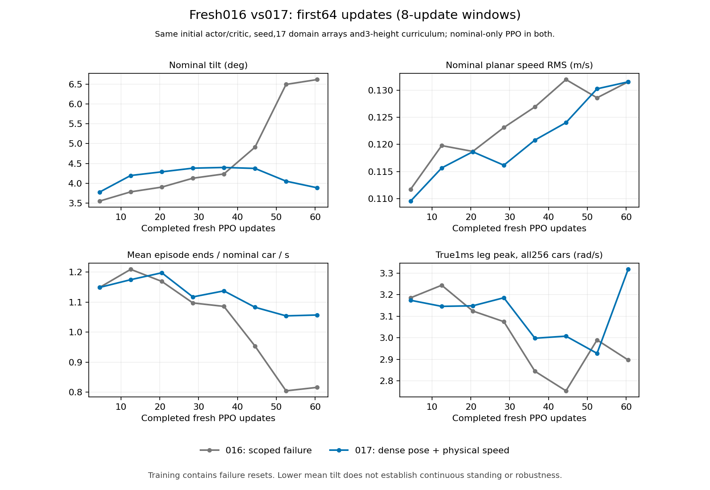

# 指定随机域的新策略退化与下一轮修复

最新状态入口为 [10月27日完整能力盘点](WHEEL_LEG_CAPABILITY_STATUS_20261027.md)。018已从零运行至387/1536，321起全部随机车参与学习；321–352及353–384纯静站速度RMS为0.20484/0.16647m/s，虽下降仍未站稳，真实腿速峰74.414rad/s。此前58.554rad/s名义恢复峰与这次随机恢复峰均已参与学习。017完整名义冷测13类仍无完整通过，013只提供中高度8秒部分证据。以下保留各阶段的原始检查过程，早段“当前”均指其记录时刻，不覆盖后续结果。

用户指定的v2最终范围保持：腿P/D和气弹簧固定1，独立惯量±6%，IMU固定roll/pitch±0.8°、yaw±0.266667°，无平台晃动，其他旧停止阶段范围保持。这里记录学习结果与归因边界，不降低永久验收要求。

当前最新闭环结果仍不合格：修复传感器采样时钟后的012已完成128次从零更新并实际退出，20项完整封存检查通过，最终模型SHA为`274dcf7cca2b351a890cd84fa0cfb995e7a790da52f07d724e1bce95993c3fd9`。305mm终末7例均未站稳，倾角峰值33.50–39.15°，v2口径最大XY偏移1.7079m；单次≤2ms失载已忽略，剩余失载241ms。这远超用户接受的微小振动，未获得长训练或实车资格。累计完整封存3713次从零更新。冷启动队列004已完成并实际退出，以下5组均为同一128更新权重、seed261201、305mm的7个固定起点；非干预域抽样及全部原生物理设置配对核验通过。

| 012冷启动评测域 | 静站通过 | 最大XY偏移 | 保留失载 |
|---|---:|---:|---:|
| 名义 | 0/7 | 1.6749m | 299ms |
| 指定v2全组合 | 0/7 | 1.7508m | 131ms |
| 关闭编码器策略/PD零偏 | 0/7 | 1.5065m | 146ms |
| 关闭策略观测延迟 | 0/7 | 1.7508m | 143ms |
| 关闭IMU固定偏角 | 0/7 | 1.8146m | 155ms |

关闭单组仍未恢复该代权重，不证明某组对训练没有影响，也不证明修复后训练到512更新一定失败。下一轮`pilot013_gradual_admission_requested001`已从提交`55b3b07e`实际启动512次从零更新，无续训或teacher。原生首更新30项核验通过：初始actor/critic、19项实际域抽样和agent超参数与012相同；真实12次Adam调用，9个actor/8个critic参数张量改变。首个实际checkpoint的actor/critic归一化计数均为10112，PPO实际有效10112条、每mini-batch2528条，均来自79个已纳入环境。原生旧字段`script_or_blend_transitions=22656`在此表示未纳入的177个随机环境样本，不能误称脚本控制。

59项配置与19项群体诊断TensorBoard标量已从RSL event回读核验，266份训练源码冻结；固定评测队列005仅等待本轮PID599642/start3112307真正完成并退出。课程已在原生PPO生效不等于平衡或鲁棒性改善，仍需观察warmup、渐进和最后全人口三个阶段，再做固定行为测试。完整技能、近满分验收、正式长训练、ONNX和RMCS部署仍未完成。

随后实读013完成22/512，原训练源码与队列12份文件均保持冻结。前1–16完整RSL窗口名义/随机群体速度RMS为0.11220/0.15821m/s，真值倾角均值3.4843/4.7227°；仍非稳定站立。当前只纳入79个名义传感器/执行器环境，随机177个环境仍真实仿真、单独记录。读数保留实际事件前缀SHA和逐更新时钟校验，详见`domain_admission_first16_002.json`、`domain_admission_live001.json`；完整封存仍3713，另观察本轮22更新，不能把3735写成全部封存或技能通过。

2026-10-27 04:55（UTC+8）实读同一013进程完成92/512，266份训练源码和等待队列005的12份文件均与冻结摘要一致。完整、互不重叠的RSL窗口如下；名义环境仍保留指定地面摩擦，随机环境尚未参与PPO/归一化。未开始全范围学习，不能据此称课程有效或失败。

| 013更新窗口 | 名义速度RMS | 随机速度RMS | 名义倾角均值 | 随机倾角均值 |
|---|---:|---:|---:|---:|
| 1–32 | 0.12133m/s | 0.16714m/s | 3.5611° | 4.8165° |
| 33–64 | 0.15328m/s | 0.20633m/s | 3.6280° | 5.1248° |
| 65–96 | 0.16692m/s | 0.22442m/s | 3.6336° | 5.2254° |
| 97–128 | 0.17817m/s | 0.23701m/s | 3.5921° | 5.2644° |
| 129–160 | 0.18785m/s | 0.25553m/s | 3.3479° | 5.3768° |
| 161–192 | 0.17522m/s | 0.26150m/s | 2.6856° | 5.5855° |
| 193–224 | 0.17502m/s | 0.30245m/s | 2.1299° | 5.0150° |
| 225–256 | 0.05455m/s | 0.30064m/s | 0.5634° | 3.4834° |
| 257–288 | 0.01089m/s | 0.26247m/s | 0.3301° | 2.1933° |
| 289–320 | 0.01825m/s | 0.24304m/s | 0.3128° | 1.8152° |
| 321–352 | 0.01436m/s | 0.17382m/s | 0.3181° | 1.7025° |
| 353–384 | 0.00862m/s | 0.08453m/s | 0.3235° | 1.7080° |
| 385–416 | 0.00644m/s | 0.03928m/s | 0.3353° | 1.7112° |
| 417–448 | 0.00419m/s | 0.01825m/s | 0.3427° | 1.6713° |

前192基础学习已结束，最后一窗倾角/速度相对前窗有所下降，但仍远未达到稳定站立。后续193–320渐进和321–512全人口阶段继续按原声明运行。较早完成123/512时，GPU进程身份、全部266份训练文件和队列12份文件核验一致；见`domain_admission_live002.json`。第四完整窗来自完成131次更新时的`domain_admission_first128_007.json`；此前第006次读取只观察到126更新、三个完整32窗，未用作128窗证据，原始数据仍保留。其余曲线证据为`domain_admission_first32_003.json`、`domain_admission_first64_004.json`、`domain_admission_first96_005.json`、`domain_admission_first160_008.json`和`domain_admission_first192_009.json`，各自绑定实际RSL event字节前缀和读取器。这里是带探索及失败自动重置的训练诊断，不是固定站立、接地或漂移验收。

随后完成162更新时，第129–160完整窗仍未出现009同阶段的基础平衡改善；009同窗速度RMS约0.00735m/s。`nominal_population_labels001.json`核验实际启动样本：79个名义环境的电机强度/P/D/气弹簧/质量/独立惯量比例全部严格为1，编码器策略/PD偏置、白噪声、IMU固定偏角、COM偏移和观测延迟均为0，传感器/执行器/刚体启用掩码一致。全部256环境的IMU晃动幅度为0，未生效的相位数值不代表仍有晃动。名义群体实际轮地有效摩擦为0.20099–0.29682，所以它不是009固定摩擦的精确重放。该检查没有新原生查询或PPO，未把名义标签错配作为新根因；训练人口、摩擦与学习路径的贡献仍需隔离。

`domain_admission_ramp_start_010.json`已实际读到200/512：最新完整原生更新纳入79个名义及9个随机环境，人口88/256，按完成时钟199计算，逐更新课程核验通过。266份训练源码和等待队列12份文件再次核验一致；没有热改、重启或另开PPO。完整封存仍3713，另观察本轮200更新，总观察3913不能写成全部完整封存。无自起、完整技能、长训练、ONNX或实车资格。

前192更新的对比图为`reports/robust_policy_repair_20261024/domain_admission_warmup192_001.png`及同名SVG；两条来源的真实TensorBoard事件字节前缀重新核验通过，生产脚本和SHA回执同名保存。图中009为256环境固定地面、013名义群体为79环境保留随机地面，已在图注明，不能当作严格单变量因果结论。

随后`domain_admission_ramp256_011.json`和`domain_admission_ramp288_012.json`实际读到263/322次更新，后者包含至320的十个完整窗口。名义平衡在225–256才出现明确改善，随机组倾角随后下降，但速度RMS仍约0.243m/s，未达到静站。最新完整原生更新322实际纳入79+177=256环境，课程时钟321，逐更新RSL核验通过。`unified_training_runtime_prepared001.json`又在330/512时确认原PID599642/start3112307仍在运行，266份训练源码及等待队列12份文件全部保持；既未热改也未提前停止。完整封存仍3713，本轮另已观察330，总观察4043不能称全部完整封存。所有这些均为带探索及失败重置的训练诊断，最终需同权重的冷启动原生评测。

`domain_admission_full416_014.json`随后读到420更新和13个完整窗口。随机组速度RMS在三个全人口窗口连续由0.17382降至0.08453、0.03928m/s，名义组最后为0.00644m/s；这是实际学习诊断的改善，尚非固定漂移/接触通过。随机组倾角仍约1.71°，不能以平均倾角或微振动替代无重置冷测。`fresh_unified_entry_prepared001.json`于434/512再次核验原进程、266份训练和等待队列12份源码均保持，未追加预算、重启或并行新原生任务。

`domain_admission_full448_015.json`又在466次更新读到417–448窗：名义/随机速度RMS为0.00419/0.01825m/s，倾角0.3427/1.6713°，改善继续。原TensorBoard事件前缀核验后导出`domain_admission_full448_002.png/svg`，速度轴为对数轴、192/320课程边界明确标注，图片已目视检查；仍注明013名义群体保留随机地面、009固定地面及人口/学习路径差异。`full_suite_height_grounding_prepared001.json`于475/512再次核验266+12份冻结源码保持。没有依据曲线提前授予固定漂移、接触或鲁棒性资格。

## 完成512次从零训练后的结果

010完整完成512次新PPO，actor、critic和Adam均从零开始。20项封存检查通过，原265份冻结源码在退出时与归档一致，最终模型SHA为`53040bcd1f9e50a9cc04a7be56d12dba0f1b1bff1b65f35f575146ffcbd9a863`。所有该轮训练与评测进程均已退出。完整封存累计3457次从零更新，未续训任何旧策略。

以下均使用同一010最终权重、seed261201、8s、305mm训练高度的7个固定倾角起点；200Hz策略、1000Hz真实接触与关节采样、64/32求解器保持。去组比较核验了实际抽样，不只比较配置。

| 评测域 | 静站通过 | 接地通过 | 最大XY偏移 | 忽略≤2ms后保留失载 |
|---|---:|---:|---:|---:|
| 全关，名义 | 0/7 | 3/7 | 1.6703m | 18ms |
| 指定v2全组合 | 0/7 | 2/7 | 1.7307m | 93ms |
| 仅移除编码器策略/PD零偏 | 0/7 | 2/7 | 1.6531m | 94ms |
| 仅移除策略观测延迟 | 0/7 | 2/7 | 1.7319m | 114ms |
| 仅移除IMU固定偏角 | 0/7 | 2/7 | 1.7535m | 95ms |
| 同一电机的策略/PD使用共同编码器零偏 | 0/7 | 2/7 | 1.6238m | 54ms |

共同零偏实验保持18项非PD实际抽样和全部原生物理设置相同，只改变PD偏置与策略偏置的相关性；各自±0.004rad范围不变、原RNG抽样仍全部消费。它符合本次只读RMCS源码审计中同一个`q_`进入策略与主机PD的反馈链，但尚非实车运行链证明，也未用于训练。

名义冷启动最终倾角约34–38°，所以这一代的失败远大于微小腿角振动。该actor连名义平衡反馈也学坏了；不能把失败仅解释为评测时噪声过大。各单项关闭后仍失败，不能归结到某一个组，也不能将即刻关闭无效当作该组对训练没有影响的证明。低/高姿态均未在该轮训练中覆盖，不能将其失败直接归因DR。

010带探索及失败重置的301–400更新窗口，平面速度RMS约0.2042m/s、倾角均值4.3877°；009名义同窗口约0.000975m/s和0.2641°。训练中原始接触比例、短重置后平均姿态、有限loss均不能替代上述无重置固定行为。

## 奖励的可验证问题与新实验

旧静站奖励将窄倾角、窄高度、窄速度的指数项相乘。0.2m/s时速度项约`5e-20`。真实失败轨迹还包含较大倾角和高度误差；只把速度项改为长尾后，在3–8s窗口仍几乎没有有效姿态奖励。这一负结果保留在`reward_signal_audit001`。

候选将联合误差`E=倾角误差+高度误差+平面速度误差+yaw误差`放入`12*upright/(1+E)`，仍扣除原角速度成本及全部真实1ms物理成本。理想峰值、各物理尺度、原终止和固定验收保持；局部二次形状相同。倒置姿态无站立正奖励，自起未完成时保留原生恢复奖励，不以站立奖励覆盖自起。它没有输出动作、冻结关节或脚本恢复控制。

对同一批失败轨迹的0PPO回算，3–8s名义/指定域的联合长尾密度约0.1478/0.1326每秒，旧形状约−0.000078/−0.000125；32个RSL标量回读一致。这只是数学奖励信号，尚不证明学习或闭环行为改善，相关局部导数也不是PPO梯度或唯一根因。

下一轮为128更新的从零单变量短训：仅选择联合长尾奖励；保留指定域最终范围、独立编码器偏置、seed261001、256×128采样、actor/critic结构、Adam配置、失败重置、名义负载初始化及305mm基础训练范围。先观察相同前100更新窗口，再做相同权重名义/指定域固定评测；旧模型只读比较。该实验不是长训练准入，也不是完整策略。

该实验随后已实际从提交`cbcf99bd`启动为`pilot011_joint_tail_requested001`。32项首更新核验通过：实际初始Adam为空，actor/critic初态与010相同，19项初始域抽样逐项相同，只有奖励形状与本次短训预算改变，54项配置RSL标量核验通过。前1–32/33–64更新的平面速度RMS分别为0.1537/0.1860m/s；010同窗口为0.1505/0.1806m/s，暂未改善。原生无重置评测尚待该进程真正完成128更新并退出，独立只读队列003已等待此边界；不根据短重置训练均值宣称站住。

011随后已完成128更新并实际退出，20项完整封存检查通过，累计完整从零更新3585。最终模型SHA为`f3de95f8f1df97ea90a64fdfe1522b210b8bfdcf5438d95acb18df15c774bfa0`。同前100更新，010/011速度RMS为0.1754/0.1790m/s，带探索重置的episode滚动均值约0.684/0.701s，未证明改善。011终末8s中高度仍0/7，倾角峰值33.46–38.72°；不能因微小振动值下降而判站稳。队列003现已完成同一权重的五组冷启动比较并退出：名义、指定域、三个去组均0/7，最大XY偏移约1.45–1.62m；名义/指定域保留失载315/137ms。这里与010最终权重的训练预算不同，不当作相同更新数的最终行为因果对照。

## 新定位：部分环境重置污染整批传感器采样时钟

`RobustDomain.reset(ids)`在存在IMU安装模型时，会把全局`last_sensor_tick`设为−1；最终接地放置函数还会再设一次。单个环境失败后重取同一物理tick的观测，因此再次采样整批白噪声并推进共享延迟环，未重置的其他车也受影响。旧无IMU对象的名义路径没有这次全局失效，固定无自动重置评测也不会重现同样的训练采样节奏。这是实际实现差异，不能解释成用户指定的随机化幅度。

直接使用真实v2采样器的CPU反例：6台车均配置一个策略tick延迟，在同tick只重置第0台；其余5台的真实关节输入已从0变为0.123rad。本应继续读延迟帧的5台被旧代码立即读入当前帧，变化均为0.123rad，游标由2变0。候选只刷新重置车，其他5台输出与全部历史逐位不变，游标保持2；域参数和RNG消费逐位配对。该0.123rad是专门隔离时钟错误的反例输入，不是实测电机抖动幅度；诊断强制延迟1tick、关闭白噪声，未修改正在运行的配置。

候选及渐进采样课程共10项CPU测试通过，涵盖真实PPO的样本与归一化掩码一致性、多个同tick重置、完整人口重置、原无IMU路径与原RNG消费。随后实际原生链复现成功：24台车中只重置最后一台，其他23台真实根姿态/关节状态逐位不变，旧代码却改变其中14台的观测，共享游标2→0。修复后23台观测和全部历史逐位不变，游标2→2，七项原生检查通过。两次seed271504、同样40个显式物理步、干预前观测、17项传感器/执行器/刚体数组与两项实际地面摩擦、原生物理设置全部配对；混合量纲观测差值不能写成真实腿运动幅度。

生产修复已提交`9d3d30f9`：部分重置只标记选中环境，同tick刷新保留原全批噪声RNG抽样但仅写这些行；新物理tick才推进一次延迟环。最终接地放置也只标记放置的环境，不再清除全局时钟。136项定向CPU检查通过。第一次CPU命令误从editable安装的主目录导入旧类而出现2项失败，原始XML保留；正确显式指向当前worktree后136/136通过。首个独立原生诊断调用漏注入helper的torch绑定而失败，亦保留并在第二次调用前修正。没有把进程exit0替代实际JSON检查。

`pilot012_isolated_sensor_requested001`已从该提交全新启动128更新短训，恢复原Gaussian奖励，以分离采样时钟修复；无渐进采样课程，无旧权重/teacher。25项首更新核验通过：actor/critic初态、原生agent超参数和19项实际域抽样与010一致，真实首更新12次Adam调用、9个actor/8个critic参数张量改变；55项RSL配置标量回读通过。固定名义/指定域评测队列004等待这个确切进程完整结束。当前实现错误已修复，尚不证明它是唯一训练退化原因或已恢复鲁棒站立。

随后实读012完成46/128，原265份训练源码与归档仍相同，队列004保持等待。相同前32更新，010/012速度RMS为0.1505/0.1545m/s，倾角均值4.3472/4.3751°，带探索重置的episode滚动均值约0.571/0.589s；这一早期窗口未证明平衡改善。累计完整封存仍3585，另已观察本轮46更新，不能把3631写成全部封存或行为通过。详见`isolated_sensor_live001.json`和`isolated_sensor_first32_001.json`。

课程候选是从零先让名义域样本学会反馈，再逐渐纳入已在启动时采样的完整随机域样本，并使归一化、PPO学习与bootstrap掩码一致。最终仍覆盖原指定范围和人口，不在运动中改质量/惯量、不加载旧权重。目前仅候选CPU实现，未采纳；先分离上述采样时钟问题。

012相同前100更新的速度RMS为0.17724m/s，010为0.17540m/s；最后97–128窗为0.19976/0.19594m/s，未见基础平衡恢复。与此同时，009名义域在129–160窗才明显改善（速度RMS0.00735m/s，episode滚动均值7.91s），161–192窗为0.00208m/s和8s。因此012的128预算不足以证明修复后更长训练也一定失败，也不能把课程和训练预算的效果混作严格单变量结论。证据来自同一RSL event的不可变字节前缀，未建立独立曲线数据源。

在012实际退出并通过完整封存后，可选课程已接入训练入口，随后在013正式采用：完成时钟0–192只纳入原79个名义传感器/执行器环境，随后128时钟渐进纳入177个随机环境；时钟320后全人口，更新321–512共192次全部纳入。所有256个环境从启动起就使用完整指定物理范围，原名义环境也保留指定地面摩擦分布；因此该warmup不是009的精确物理重放。优先次序使用独立随机生成器，不改变原生域参数或主RNG。

实际集成的15项CPU预检通过，266份训练源码含课程helper；56项相关CPU检查通过、6项原生opt-in测试明确跳过。真值的名义/随机/已纳入群体速度、倾角、高度、结束事件分别接入RSL TensorBoard，PPO和归一化使用相同原生掩码。默认不开启时沿用原训练行为。评测队列004冻结的12份文件全部未变，仍从012自身归档读取actor、核心环境和训练入口。只有固定评测结束并实际退出后才启动下一轮；本次预检不构成原生或鲁棒性通过。具体回执见`domain_admission_integrated_preflight001.json`。

随后仍须解决早期三高度覆盖、平滑变高、全部初始与运动中翻倒自起、低/高速直行和四向转弯、双向80–100rpm原地自旋及变高、急停、跨种子和完整随机域。198案例完整套件目前只完成CPU预检，不能称原生通过。通过标准始终见`WHEEL_LEG_ACCEPTANCE.md`和v2机器合同；自起完成后起算接地、≤2ms忽略原始保留、后续再摔倒不得移动起点。

为后续三高度早期覆盖，另有尚未采纳的`height_initialization_candidate.py`：将已认证机制静态初值拟合为普通可训练高度系数，直接使用当前scut35的`frame[3]=5*height`，不经过经验归一化；四腿系数、六输出网络和std均保持可训练。三项CPU检查验证三个锚点、真实CPU PPO更新该参数及网络、六输出推理副本一致性；无原生行为、未加入012，不是部署导出。它用于避免只训练305mm后低/高高度输入严重超出归一化覆盖，不代替动态变高和完整自起学习。

## 完整自起训练前的奖励阶段修复候选

实际模块CPU反例确认两个独立问题。默认Gaussian精细静站奖励仅判断零指令，因而会覆盖仍在自起的原生恢复奖励；联合长尾虽排除返回样本仍在恢复的车，却与Gaussian一样在真实完成转换上覆盖原生完成奖励。物理静站成本又按`recovery_lane`出生类别排除环境，导致倒地出生的车即使已完成自起，也始终不支付这套静站腿速、接触和力矩变化成本。

`scripts/standing_phase_reward_candidate.py`生成两文件补丁：精细静站奖励同时使用物理区间起点恢复状态与重置前区间终点诊断，仅在整个区间均脱离恢复时替换奖励，保留实际完成转换奖励及再次摔倒的恢复奖励；物理成本按区间起点的实际`recovery_active`判断，自起完成后的下一个区间开始与正常站立支付相同成本。动作、完成事件、机械终止和固定验收均不改。

7项CPU检查通过，覆盖实际旧代码反例、两种奖励形状、完成转换、再次摔倒、自动重置后的新恢复状态、出生类别成本差异和非零运动/被动区间。原生奖励与接触输入为合成测试样本，未进行新的Isaac步或PPO；不能把它写成原生自起改善。完整回执及补丁位于`reports/robust_policy_repair_20261024/standing_phase_prepared001.json`和`standing_phase_candidate001/integration.patch`。候选未应用，013仍使用原冻结源码；该问题也不直接解释当前纯静站DR退化。须等待013实际退出并完整封存，再应用与验证真实阶段切换。

## 完整能力常驻混采数据候选

`scripts/unified_training_cases_candidate.py`另行准备了独立训练种子的reset数据；未读取固定评测合同，也未接入当前013。拟在全新actor/critic/空Adam下，从三个高度的基础站立逐渐引入其它任务，完整阶段保留25%静站、20%初始恢复及低/高速、双向80/100rpm自旋、四向转弯、三种变高、急停和运动翻倒恢复的常驻份额。平滑度与完整指定随机域作为全部任务的共同检查，而非单独用一个好片段代替。192/768课程时钟和份额均是未验证的工程候选，不能称已选出最优课程。

6项CPU检查通过：所有最终任务不被人口取整吞掉；基础段从一开始包含三个高度；六类倒地及对称/非对称腿都有出生与后续站/行指令；真实现有指令投影保持双向80/100rpm及可行四向弧线；六种运动翻倒组合各含双向外推、必须实际摔倒；变高/制动包含真实时序并留足跑道；reset独立RNG复现且不污染全局RNG或源姿态库。转弯、变高与制动时刻独立采样，未照抄held-out边界。

回执为`unified_training_cases_prepared001.json`。它是课程数据候选，0原生步/0PPO，未获得任何技能资格。接入前仍须实现并验证：训练模式真实执行命令序列同时保持原生自动重置、按case真实超时、不通过随机改episode时钟伪造已走过动作、正确接地的初始运动姿态，以及前述奖励阶段修复。当前旧训练入口的teacher/旧checkpoint路径不可复用作新策略初始化。

## 命令序列、真实时钟及初始接地的运行候选

`scripts/unified_training_runtime_candidate.py`已准备原生两文件补丁和独立训练环境工厂。原`RobustGetupEnv.step()`仅在`fixed_cases`非空时执行序列，但该模式同时关闭自动重置；正常训练则每4s重采无关指令，并且超时只看统一最大时长。候选用显式训练开关执行真实序列，保留`fixed_cases=None`的原生自动重置，屏蔽这套训练的无关重采样，并使用原有逐环境`episode_limits`区分18s高速直行和30s其它场景。

回合时钟从实际reset的0开始，每个物理区间必须只前进1个策略步或在真实done后归0；随机改初始episode长度会被拒绝。姿态和指令只在选中环境reset时写入，未结束环境保持，世界朝向变化不改变倒地姿态与地面关系。初始接地辅助函数新增可选模式，只为正常直立出生的运动/自旋环境正确放置；倒地出生不调用该放置。原五个1ms物理子步、六电机RL动作、机械/冲击保护及部分重置传感器缓存修复保持。

完整任务数据也补上指令难度课程：仅增加任务人口却立刻请求100rpm时，静止附近原生yaw跟踪项约`exp(-(10.472/0.75)^2)`，几乎为零。候选在每次reset时同步渐增速度、yaw和变高幅度，终点仍是完整3/−2.5m/s及双向80/100rpm；序列时间不变，没有运行时动作过滤。该数学信号问题不等于已证明的闭环训练根因，192/768时钟仍是待验证工程选择。

16项CPU检查通过：8项任务覆盖/投影/RNG/早期奖励信号，8项实际原生序列/超时/重置代码块、接地选择器与真实时钟检查。环境工厂使用合成协议类验证动作透传、选择性reset及终止前指标归属，尚未实例化真正Isaac环境，不能称原生行为通过。阶段奖励和运行补丁一起`git apply --check`通过，但均未应用；013全部冻结源码保持。回执`unified_training_runtime_prepared001.json`和`unified_training_runtime_candidate001/integration.patch`，仍缺全新训练入口、真实原生验证及同一策略的完整13能力测试。

## 全新完整任务训练入口的配置预检

`scripts/train_fresh_unified.py`已建立独立入口，复用已认证机制构造与从零初始化，不复用旧统一训练的teacher/父checkpoint路径。原256环境的机制合同经独立CPU设计检查与128×128m平地工厂构造通过，200Hz策略/1kHz物理与PD、160/2.5和64/32保持。所有高度从开始覆盖，18/30s真实场景时长、逐环境自动重置与完整常驻任务由前述候选驱动；静站失败重置包装未安装，避免把真实翻倒提前截断为另一个出生。

高度项只用已认证几何和静态载荷报告初始化普通可训练参数，源bank/asset、305mm常数偏置和全部系数单位均核验，六输出MLP及critic均可训练，Adam初态必须为空。训练入口全程禁止`torch.load`，启动前必须与同一Git提交的272份源逐字节相同；阶段/运行源码尚未采纳时在Isaac启动前拒绝。当前默认1536只是未启动的有界候选计划，须依据013冷测结果决定，不是已获长训资格，也没有加载013或009继续学习。

新`scripts/fresh_physical_metrics.py`把已校准的全rollout真峰值观察接到现有RSL writer，覆盖每个策略区间五个真实1ms腿速样本，直接记录最大值及≥3/10/50rad/s样本数。单个50rad/s尖峰的CPU反例正确保留50及1个样本，动作和step返回对象不变；不再用旧extras经平均的“peak”排除危险速度。它没有改变动作、reward或物理过程，也没有宣称实际新训练已经没有高速样本。

入口/机械来源/域范围与真峰值7项、完整参数封存2项CPU检查通过；新版封存器会计入新增2×4高度系数、真实18个actor/critic参数张量，并要求完整任务与真物理峰值RSL记录，不强行要求尚未完成长回合时已有episode均值。用真实已结束012再次检查，原19项不含当前源匹配的封存检查全部通过。首轮CPU测试误读独立预检字段`passed`而失败，已按真实`status=static_passed`修正并保留失败XML；不隐去负结果。

配置与回执为`fresh_unified_entry_preflight004/`和`fresh_unified_entry_prepared001.json`。尚未运行新入口的Isaac步或PPO；其原生命令/接地/阶段验证、冷评测器高度actor支持及完整13项同策略测试仍待完成。013继续原512及自身终评/冷测队列，不用这些配置检查替代行为证据。

## 完整套件的高度actor及运动出生接地准备

`evaluate_fresh_full_suite.py`现已允许新高度actor，并认证保存的静态初始化参考和实际三层继承源：高度项、腿速隔离、轮速增量必须全部来自该checkpoint的冻结归档。缺任一依赖、换用工作目录类、系数形状或初始化来源不符均拒绝。

评测初始化改为直接使用原生`RobustGetupEnv`，避免旧`ScratchStandingEnv`已安装的“仅零指令放置”遗漏初始运动/自旋姿态。新归档使用`include_motion=True`；旧归档只在单独冻结的诊断副本将接地选择器改为全部非倒地出生，其原放置计算与传感器时钟保持。倒地出生不放置，评测循环没有reset或状态写入。该差异是明确的初态修正，不宣称旧静站轨迹与新完整套件逐位相同。

新增3项源码/选择器检查与原完整套件19项共22项CPU检查通过，实际009同一512权重重新完成198案例配置预检，0原生步/0PPO。回执`full_suite_height_grounding_prepared001.json`、`full_suite009_height_grounding_preflight002/`；新高度checkpoint尚不存在，真实完整套件、动态自起及全部技能仍未验证。013及其冷测队列的冻结文件均未改变。

## 013实际结束与完整任务代码采纳

013已完整完成512次从零更新，原PID599642/start3112307实际退出；退出后、修改任何核心源码前，20项完整封存检查全部通过，包括原266份当前源码与归档一致。累计完整封存4225次从零更新。最终481–512窗的名义/随机速度RMS为0.00353/0.01535m/s，随机倾角均值1.6796°，属于实际带探索训练诊断，不能当成最大漂移与连续接触结果。

其自身暖场8s终评，305mm按v2通过7/7、最大XY偏移2.103cm，最长原始失载2ms，保留失载0；腿角3–95Hz RMS均值0.18310mrad（0.01049°）。230/420mm仍各0/7、最大XY约0.505/0.458m，不能把未训练高度称为鲁棒通过。独立冷启动名义评测随后305mm为7/7、最大XY1.709cm、腿角RMS0.07914mrad，最长2ms且保留失载0；指定域及有条件去组评测仍在串行运行。没有拼接暖/冷或不同高度的最好数据。

完成上述退出和封存后，才将前述阶段奖励与命令序列/逐case超时/运动出生接地的四文件补丁采纳到工作源码。54项CPU检查通过，历史旧奖励和旧放置源码以带SHA的fixture保留，继续验证旧错误反例。完整入口再次完成272份源码配置预检。冷测队列冻结的12份文件全部保持，旧actor和核心环境继续从013自己的归档读取，不会改用新源码。

新增原生验证入口`verify_fresh_unified_runtime.py`必须先等013及整条冷测队列的确切进程退出。它计划以全新随机网络验证真实命令切换、短场景真实多次超时/复位、运动和自旋出生接地、同tick局部复位隔离、原生稳定完成事件与完成奖励、完成后的静站成本、200Hz/1kHz及64/32。恢复正对照物理初态为直立，仅显式标记逻辑恢复状态，所以不能用它证明倒地翻身。该入口不执行PPO或读取旧权重；必须实际通过且退出，完整训练入口才接受绑定相同源码和bank的回执开始全新PPO。

本次仅采纳源码并做CPU检查，尚未运行上述原生验证或完整任务训练。回执`fresh_native_adoption001.json`、`scratch_pilot013_closed_seal001.json`、`domain_admission_terminal_review001.json`、`domain_admission_final512_016.json`和`fresh_unified_entry_preflight005/`保存边界。完整13能力、三高度随机域、30s、留出种子、正式长训、ONNX及RMCS集成仍待完成。

另31项既有静站奖励/接触/从零模型回归检查通过。首次扩大检查时包含工作树未附带的历史24500 PT fixture，产生6项失败和65项setup错误；还有两项旧精细奖励mock缺少真实环境已有的恢复阶段字段。补全两项mock的明确区间前后状态后，这31项通过；未虚构或恢复历史模型来制造全绿。原失败XML与后续通过XML及SHA保留于`fresh_native_adoption_regression002.json`，不声称未具备fixture的历史套件通过。

五组冷测随后全部完成并实际退出，11项来源/进程/同PT/实际物理/抽样配对检查通过。相同013权重的305mm名义/指定域/去编码器零偏/去策略延迟/去IMU偏角通过数依次7/7、7/7、6/7、7/7、7/7，最大XY偏移依次1.709/5.619/4.770/5.411/6.036cm；去编码器零偏有6ms保留失载，其余为0。指定宽度不缩小也已恢复中高度静站，但漂移和低/高高度仍不理想；没有根据单次去组的变化给各组分配唯一训练因果份额。来源`domain_admission_cold_comparison001.json`，012只有128更新、013有512更新，这一预算差异仍明确保留。

新完整任务课程补充了reset姿态难度：从同家族、同对称/非对称腿形的既有验证库中选较小倾角，逐渐到原90°侧/前/后倒与180°翻倒终点；倒置家族最小已有120°，复合家族只有65°可用，未制造更容易的姿态。原全角终点池不变，不插值根姿态或关节、不写运行中轨迹。39项数据/运行/入口检查与再次272份源配置预检通过，见`fresh_case_progression_prepared001.json`和`fresh_unified_entry_preflight006/`。尚无新PPO或原生自起成绩；先执行真实管线验证。

随后`fresh_unified_native001`真实实例化128环境并执行144策略区间/720物理步，12项原生检查全部通过，其12项RSL标量逐项读回一致，原进程实际退出。两个短case分别17/12次真实自动复位，运动/自旋出生已接地，同tick局部reset未改变其他车状态、观测或延迟环。物理直立的逻辑恢复正对照在0.505s达到原生稳定完成事件，完成奖励保留，下一物理区间开始支付正常静站成本。初始化后的全部参数、归一化状态和空Adam保持；0PPO/0旧checkpoint读取。该正对照不代表倒地自起通过，观测腿速峰5.092rad/s只描述这0.72s诊断。

`fresh_unified_native001_verified.json`据此冻结014有界试训计划：全新actor/critic/空Adam、256×128、seed271001、1536次更新；三高度起步、任务人口/请求幅度/验证库姿态192–768渐进、768后完整常驻任务，随机域人口192–320渐入且物理宽度从启动即为完整指定范围。独立原生回执与当前272份源及bank一致才允许启动。它是验证多能力学习的试训，不是近全项通过后的正式长训练；同一最终PT的冷启动完整13能力仍须实际测量，禁止续训013或拼接不同代最好数据。

014确实执行了1次原生PPO/12次Adam调用，10个actor及8个critic参数张量改变，随后真峰值日志缓存清零发生PyTorch inference tensor错误，训练退出。已核对确切进程退出及272份冻结源未变；只有update0的初始PT保存，不能把首更新审计当作已保存的更新后权重。失败更新仍计入消费：完整结束的试训4225次，014失败消费1次，实际累计4226次，不退款、不续训014。

错误来自采样阶段以新tensor替换持久峰值缓存，随后在推理模式之外清零。改为向原普通tensor执行`copy_`，并补测连续两轮真实推理模式采样与模式外日志清零边界；26项和24项有重叠的定向CPU检查分别通过。Context7当前未提供可调用工具，故核对本机PyTorch2.11对应的官方[inference_mode文档](https://docs.pytorch.org/docs/2.11/generated/torch.autograd.grad_mode.inference_mode.html)与[copy_文档](https://docs.pytorch.org/docs/2.11/generated/torch.Tensor.copy_.html)。这是日志兼容修复，不是新策略效果结论。

原生入口新增第13项`physical_extrema_flush_after_inference`，必须在真实Isaac采样后通过RSL writer写出峰值并在模式外清空缓存。旧native001回执缺此项且源不同，不再能准入新训练。修复源提交`2eed1c58`后，新的native002实际144策略/720物理步通过全部13项；13项RSL检查及峰值标量读回一致，确切进程已正常退出，273份源保持。该0.72s诊断峰值仍为5.092rad/s，与旧诊断一致；仅证明记录逻辑修复，不是长训腿速或倒地自起达标。`fresh_unified_native002_verified.json`绑定015全新actor/critic/空Adam重开相同1536次有界试训，前述三高度/任务/域课程保持。不得读取014或013权重。

015从提交`8d626c76`真实启动，28项首PPO检查通过：初态与014独立重建一致，首更新10actor/8critic张量及12Adam调用一致，日志修复未改变首更新结果；仅68名义车被准入，8704有效转移/2176最小minibatch、首checkpoint两归一化count均8704。连续真实rollout的峰值写出和清零已正常工作。198场完整评测仅通过CPU配置预检，0原生行为步，不算能力通过。

随后监控发现三高度名义基础已失败：第2更新开始约27°、第3更新约34°倾角，高度误差约55.6mm，而速度RMS约2mm/s只是倒住后的近静止。不得据低速度宣布静站改善。013仅305mm基础在相近早期约3–4°、1–2mm高度误差，两者任务/初始化范围不同，不能分配唯一退化因果；015尚未准入随机域学习，名义组也失败，不能只怪随机化强度。

因此015于完成55更新时仅发送一次SIGTERM，在第56更新边界保存`model_stopped.pt`后正常退出。13项停止完整性核对通过，272份源保持、18个Adam状态均672步，PT SHA为`e10b6481f3a0fd3b567ebd0485e1a0a31103f10847800bd6606eba47bffdc781`。原生RSL任务均值55点，最后一次停止异常在`logger.log`前抛出，真峰值则完整56点；最后已消费的更新不抹去。全56更新腿速峰5.830rad/s、≥50rad/s样本0，但站姿失败，不能以此称策略平滑可用。实际累计消费4282=完整试训4225+014失败1+015停止56，均不续训/退款。1536次有界计划未完成，完整任务渐进尚未开始。

新的0PPO诊断预先冻结168场（8对照×3高度×7初始pitch、8s）：初始均值/采样、每128步只更新统计的均值/采样、初始参数配首更新统计、真实首更新均值、停止权重均值、去初始MLP残差的机械目标均值。全部读取发生在停止后的只读诊断，原生控制/物理/保护保持；机械目标及统计替换是诊断干预，不能当作RL效果或部署方案。39项有重叠的诊断/完整评测/队列CPU检查通过，原生待运行，见`fresh_height_start_diagnostic_prepared001.json`。

已准备`queue_fresh_full_suite.py`，但未启动，也不会接受015停止状态。它仅在未来完整新训练的确切进程和GPU退出、完整性封存通过后，串行测试同一最终PT的2种子×名义/指定域×198场。评测显式派生唯一`nominal_fraction:0.25→0`，让指定域每场都真实随机，其他参数宽度不变，原训练25%名义复习不变；共792场记录不表示792场通过。代码拒绝旧PT替代、失败训练重启、种子/源/物理/场景错配和假随机标签。

## 168场实际诊断与纯静站失败信号修复

上述8组对照现已实际完成，1600策略区间/8000物理步、168车、0PPO，原进程退出。13项只读来源/轨迹/物理/RSL核对通过，48个TensorBoard诊断tag各有完整8个时刻；原始轨迹SHA为`b5a32344b7fd9bb911a711764961b871a52a030d580d426552a11d0fef2e517e`。更换统计、每128步更新统计及移除初始MLP残差均未解决名义平衡失败。初始均值网络在230/305/420mm的7例终末倾角均值约20.68/34.64/49.02°，不能把静态载荷初始化当作动态平衡控制器。该反证不支持把归一化定为唯一主因，诊断干预不进入训练或部署。

进一步查到一个确切配置差异：013实际启用`--standing-failures --desync-episodes`、8s且只训练305mm；015为保留自起过程，去掉了静站失败终止，改为30s且同时训练三高度。原生倒地门没有把约20–35°靠机身支撑、几乎不动的姿态全部终止，精细高斯姿态奖励却已经接近0，导致长期无有效站姿回报。它是有证据支持的学习信号缺陷，仍待新的闭环实验确认收益；任务、初态、时钟差异尚未全部拆开。013早期3–4°均值受失败重置影响，不能与015无该重置的均值直接比较为稳定性改善；013无中途重置的冷测305mm实际7/7证据继续有效。

新增`fresh_standing_failures.py`仅对纯`standing`训练case、直立出生且本区间原生学习mask有效的车恢复原20°倾角或25mm高度误差失败条件，额外成本仍为3；在实际失败时设done、禁止超时bootstrap、按原生流程reset。域准入mask在其外层筛PPO和归一化样本，因此未准入的随机车也会物理失败重置，不能把失败tag人口解释为实际学习人口。场景身份和恢复出生标记在step前保存，避免自动reset后的标签错配。初始自起、运动翻倒、其他运动和变高case保留原生恢复时间，固定评测完全绕开包装；动作、PD、接触门、保护和全部指定域宽度不改。新增三个失败事件tag写入原RSL event，完整封存要求这些tag逐更新齐全。实际回合时钟仍从0开始，未恢复随机回合长度。

45项CPU检查通过，含纯静站失败惩罚一次、原生已结束不重复惩罚、恢复完成奖励保留、运动翻倒/自起/变高不被误截断、固定评测全轨迹与初始化/来源封存要求。一次测试命令误用了不存在的历史文件名，未执行测试，失败XML保留；正确文件集合随后两次45项通过，其中第二次包括新增封存tag要求，计数不相加。

下一轮原生003先检验新终止的真实事件、无bootstrap和真实回合归0，并复验既有恢复完成奖励及物理设置；须14项全部实际通过、退出并绑定当前273份训练源后，才允许新016从空Adam/新actor和critic启动1536次有界试训。种子271001、256×128、基础192、完整任务768、域准入192+128、三高度和域宽度全部保持，唯一新增学习处理为纯静站失败信号。015停止权重仅作上述诊断，绝不续训或teacher。累计已消费仍4282，后续新增实际更新另记，不退款。

该轮是否学会，需由无失败重置的同一最终PT冷测判断；低训练均值、频繁reset、无50rad/s样本都不能替代13项能力、连续接触和漂移验收。正式长训、ONNX和RMCS集成尚未获行为准入。

`fresh_unified_native003`随后从提交`43130f71`实际运行144策略区间/720物理步，14项检查及其TensorBoard标量全部读回通过，274份源（训练273+验证入口1）保持、原PID805001实际退出。特设6°纯静站出生真实触发2次失败，两次done/terminated、非timeout/非bootstrap及实际回合时钟归0均核验；逻辑恢复正对照仍在0.505s完成并保留奖励。该验证0PPO/0旧PT读取，只授予新016的运行接线准入，不证明倒地自起或平衡能力。来源`fresh_unified_native003_verified.json`，其明确1536次从零计划保持，尚非正式长训练。

016已从提交`199fbb87`实际启动，PID807101/start4222621、273份训练源冻结，首3更新29项核验通过。新网络初态和17项实际域抽样与015一致，初始Adam为空、首12次Adam调用真实执行，10个actor和8个critic参数张量改变。68名义/188随机车中，此时仅68名义车参与PPO和归一化，真实有效8704条、minibatch2176、首checkpoint两归一化计数均8704。首完整rollout腿速峰3.081rad/s、≥10/50rad/s样本均0，只是早期安全诊断。

读取到17更新的两个8窗：名义倾角3.55/3.78°、高度MAE1.49/1.57mm，速度RMS0.112/0.120m/s，名义每策略步失败/结束事件均值0.391/0.411。虽已不再长期倒住，但仍频繁失败，不能称静站或鲁棒性通过。该统计受到新增终止与重置影响，不能直接以均值降低证明闭环能力改善。完整评测队列PID809237/start4233064已启动且仅等待本轮确切退出，当前无评测子进程；冻结12份队列依赖，训练结束后才封存及串行执行既定792场同PT冷测，训练生命周期不依赖该等待进程。来源`fresh_unified016_first_verified001.json`和`fresh_unified016_first8_001.json`。

后续原进程完成66更新时，273份训练与12份等待队列源均逐字节保持。两个32窗名义速度RMS约0.118/0.130m/s、倾角3.84/5.56°、高度MAE1.71/3.08mm，每策略步结束事件0.393/0.311；仍是失败训练。全66更新、每更新655360个真实1ms腿电机样本的峰值3.244rad/s、≥50rad/s计数0，不用这些安全诊断替代站姿。前32更新图`fresh_scoped_failure_first32_001.png/svg`完全来自两代RSL event字节前缀；标明均值改变含失败重置和3高度、相同初始参数/抽样。图片已目视检查，没有把015倒住后约0.002m/s称为优秀静站。

为保证后续ONNX校验使用真实输入，发现完整评测原先只保存真值而未保存带噪/延迟策略帧，已在016完成72更新时只向等待队列809237发送一次SIGTERM。队列实际停止退出、12份原源封存及训练273份源保持的5项闭合检查通过；未向训练发送信号，训练在完成74更新时仍持续。旧等待回执和原快照保留。随后仅修改两份非训练依赖的评测/队列脚本：每20策略步保存实际原始35D输入、未经动作裁剪的确定性6D网络均值及原生valid掩码，另存NPZ和SHA，约每30s198车增加8.3MB输入；队列拒绝错误PT、缺测/首车删失、非有限有效值及损坏SHA。数据用于数值导出校验，不改变动作、reward或行为判定。

46项相关CPU检查通过，包括实际高度/归一化actor在噪声帧、后续重置覆盖后仍能精确重放保存的均值输出。198场配置预检又通过，明确用本轮第1更新checkpoint做来源检查、0原生步，未声称新采样已原生通过。下一只读等待队列改用独立`fresh_full_suite_queue016b`目录及新12份冻结源；原训练273份源完全不改。后续真实评测结束才可验证300×198原始输入/均值记录并据此比较ONNX。

另完成RMCS离线接口审计，机械spec匹配。被检查文件`wheel-leg-infantry-rl.yaml`当前是50Hz、三周期60ms失效、腿目标偏移±0.75rad、yaw上限4rad/s（38.20rpm）；本轮实际为200Hz、getup腿动作clip16×0.25=±4rad、100rpm请求。尤其基础cfg的`v5_control.action_clip=3`会在原生构造被getup设置16覆盖，导出时不能误读旧字段。未来部署须绑定同PT的完整均值/归一化/高度系数/轮速增量、更新频率/动作/指令合同，并保留遥控/CAN/IMU/过期非有限推理停止及相对角力矩保护。尚未导出候选、改动RMCS或运行实车；此处只证明所读配置文件的差异，不推断实车当前启动了哪个profile。来源`fresh_deployment_interface_audit001.json`。

## 132更新、时间参数和短测范围复核

016b新等待队列已实际启动，PID836036/start4370213，只等待原训练PID807101/start4222621。训练完成132更新时，273份训练与新12份队列源均与各自归档保持，队列没有原生子进程。新97–128窗名义倾角9.605°、高度MAE6.157mm、速度RMS0.1265m/s、68台合计每策略步结束事件0.1863。相较前窗，结束减少但倾角增加，仍未站稳；此时随机车尚未进入PPO。全部132更新1ms腿速真峰值3.244rad/s、≥50rad/s样本0，不能以未见危险速度替代行为通过。来源`fresh_unified016_live128_006.json`。

读取本轮冻结agent配置，γ为0.9974905699336811（0.99的1/4次方）、λ为0.9872585449014338（0.95的1/4次方），与013一致，已正确适配200Hz；对应折扣时间常数约1.990s、GAE联合衰减约0.326s。本项没有发现时间换算错误，未据此修改当前训练。

又从013原始结果核验实际域mask，305mm指定域7台实际为6随机+1名义，名义车仍有独立地面摩擦抽样。此前“7/7”是旧8秒基础条件加v2接地标签，不含既有5cm最大XY限制；加入该限制后为5/7，其中实际随机车4/6。指定域最大XY仍为5.619cm、保留失载0，未改变任何原数据或接地容差。低/高位各0/7，无30秒/第二种子/其他能力通过。来源`fresh_capability_scope_read001.json`，138个新范围/计数标量通过原RSL Logger写入并逐项读回；0新原生步/0PPO。后续016b指定域全198台必须实际随机，避免标签混淆。完整13项逐项状态现见`WHEEL_LEG_CAPABILITY_STATUS_20261027.md`，不能把013部分静站或历史009/115最好成绩拼成整代合格。

证据入口：`reports/robust_policy_repair_20261024/requested_domains_closed005.json`、`scratch_pilot010_closed_seal001.json`、`reward_signal_audit002.result.json`、`joint_tail_closed001.json`、`sensor_reset_isolation_cpu001.result.json`、`isolated_sensor_native_verification001.json`、`isolated_sensor_first_verification001.json`、`fresh_unified014_failed_closure001.json`、`fresh_extrema_inference_fix_prepared001.json`、`fresh_unified015_first_verified001.json`、`fresh_unified015_stopped_closure001.json`及`fresh_height_start_native001_verified.json`，原生轨迹和RSL event位于回执所列主工作目录。没有开始正式长训练、导出ONNX、修改实车或取得部署资格。

## 016全量域后停止、真实静站与瞬时腿速

016b等待队列先在329更新时单独正常退出，无评测子进程、未向训练发送信号；随后仅向原训练发送一次SIGTERM，在330完整更新后退出、保存`model_stopped.pt`。17项停止完整性检查全部通过，273份训练和12份队列源保持、原训练及GPU退出、18项Adam步数3960、初态空Adam且没有旧PT读取、完整模型/RNG有限。PT SHA `7cc58df3231632983b6e4cd432b98df715536e9e66a9186f92829f5d52cc3cd9`。真极值330次齐全，普通RSL329次，最后一次保存后停止异常先于普通logger；累计消费4612，不退款。来源`fresh_unified016_stopped_closure001.json`及其独立CPU读取器。

全330实际1ms电机峰值50.9667rad/s，≥50样本7个。先前319更新快照的4个是当时数值，早段3.244rad/s也仅限基础192，不代表全程。`FreshTasks/standing`只取纯静站真实角色，161–192倾角11.504°、高度MAE7.290mm，289–320已恶化至18.374°/12.516mm、速度RMS0.0709m/s；包含尚未PPO准入随机车的物理状态。192后名义人口包含恢复/运动，不再将名义混合角色均值称为纯静站。全量域在320达到，330停止，没有走到全部技能常驻的768阶段，也没有完成792场全评测。

原生恢复腿速成本只取5ms区间末速度，且只在恢复阶段付出，不能据此保证区间中每1ms峰值有对应惩罚；静站物理成本逐1ms采样，但只在零请求、非恢复有效阶段。全局训练峰值缺车号/力矩/角色，仍不能区分弹簧接触引发的被动腿动与策略施力。新`diagnose_fresh_peak_window.py`按预区间阶段保存被动落稳/主动恢复/普通控制，逐1ms配对真实速度与实际电机力矩，覆盖完整198固定case的首2秒，排除已结束车且保留区间间峰。3项CPU峰值测试通过，含被动力矩0的50峰、36主动峰及已结束样本排除。两份配置预检0原生/0PPO，原生结果仍待实际运行；其独立种子不是训练现场准确重放。

CPU只读反馈探针使用三高度静态传感器帧，对重力角±0.001rad、gyroY±0.02rad/s、轮速±0.1和单腿速±0.1作成对扰动。016初态/65/129/193共12行、360个RSL标量完整读回，013的193/512另进程同一实际查询帧6行/72标量读回。016193中高附近重力角到轮输出导数约[0.0838,-0.1073]，013193约[2.3714,-1.9007]、013512约[0.2568,-0.8230]；只证明查询处反馈差异，不能据种子/网络/课程不同的对比认定唯一高度干扰原因、正确反馈符号或原生稳定性。actor/归一化及PT保持，0PPO，不把旧策略梯度或权重当teacher。

准备但未采用的纯静站姿态成本为`2*log1p(2*clamp(1+gravity_z,0,2)/sin(5deg)^2)`，修补17°静止倾斜处高斯得分已近0的稀疏信号。4项CPU测试覆盖直立/倒扣、可忽略0.0036°、预区间与pre-reset角色/恢复门和固定评测旁路。只影响纯静站直立出生奖励，不改动作/PD/域宽度/运动和恢复奖励。联合7项CPU多次通过，未构成收益证据；原生峰值来源核查及新鲜网络闭环验证前不作为正式训练配置。

## 2秒原生分阶段结果与下一轮017

同一016停止PT、独立case种子271301，名义/指定域各198车实际400策略步、2000物理步，两进程均已退出、源/权重/轨迹SHA核验通过，各108个原RSL标量读回。名义被动/主动恢复/普通控制峰值35.469/46.919/13.310rad/s，指定域36.534/69.320/15.593rad/s。被动最坏样本实际电机力矩全0；指定域主动峰值来自后倒对称自起，在1.254s右膝-69.320rad/s、实际+35.757N·m反向制动，≥50样本63个。它不是策略命令69rad/s的证据，也不是训练现场50.967峰的准确重放；两者都需保留，短测不授予恢复或其他能力通过。来源`fresh016_native_peak_comparison001.json`。

017准备保留016的全部域宽度、三高度、256×128、种子和192/768/192+128课程，唯一新增两项明确奖励：纯静站直立出生的稠密姿态成本，以及全部主动任务（包含自起）逐5个真实1ms样本和4腿平均的`0.2*(dq/5)^2`成本。被动落地、已结束车和固定评测不付新增成本；不改动作、PD、物理、保护或随机化。后者不是控制器速度硬帽，也不能保证杜绝峰值。28项CPU通过，配置预检274份源、0原生/0PPO；17项原生接线验证通过并退出后才允许新actor/critic/空Adam启动，不能恢复016PT。来源`fresh_unified017_prepared001.json`。

017原生接线验证005已完成144策略步/720物理步，17项检查及17个RSL验收标量全部读回、进程退出，275份验证源（含274份训练源）保持。实际稠密姿态成本按pre-reset状态结算、主动速度成本覆盖5个1ms样本，原生恢复完成奖励/超时重置及保护保持；逻辑恢复正对照出生直立，不是倒地自起成功。配置身份校验004曾在启动前拒绝完整队列身份，0原生/0PPO；修正PID/start字段后2项正负测试通过，原失败日志保留。017现可按原1536有界计划从空Adam启动，仍非正式长训或行为通过。来源`fresh_unified_native005_verified.json`。

017已从提交`06f0d49a`实际启动，PID915858/start4794969、274份训练源冻结，1536次有界试训。首5更新只读31项检查通过，actor10/critic8参数张量真实更新、初态空Adam、无旧PT读取；与016初始网络和17项实际域抽样逐项相同，首次实际有效8704样本/minibatch2176、两归一化计数8704。新6个`FreshObjective/*`标签均有实际有限值；首655360个1ms腿样本峰3.081rad/s、≥10/50均0，仅为早期诊断。前192更新仍仅68名义车参与学习，188随机车已完整物理随机化。完整学习、无重置冷测和全部13项仍未通过，不能将启动正确解释为鲁棒性改善。来源`fresh_unified017_first_verified001.json`。

017完成35更新时，274份训练源及017等待队列的12份源均保持。首1–32窗名义倾角4.160°/高度MAE1.948mm/速度RMS0.1150m/s，结束事件0.3943/策略步；上一轮同期3.841°，尚无改善。所有原生纯静站车（含未PPO准入随机车）为6.414°/3.486mm/0.1417m/s；全35更新真峰3.186rad/s、≥50样本0。新增姿态成本全物理人口密度均值1.790/s，不能当名义PPO实付均值。首窗少不足以证明收益或最终失败，继续按已冻结计划观察。来源`fresh_unified017_first32_002.json`。

017完整评测等待进程PID919235/start4811098、session24895，独立等待本轮准确1536终点和训练/GPU退出。当前无评测子进程、0评测步，随后只允许同一final PT串行两种子×名义/实际全随机×198场=792。来源`fresh_full_suite_queue017_launch001.json`，不以排队代替通过。

另从两份已存在的2秒原生轨迹做CPU范围复核：48个初始自起案例中，名义42个、指定域43个在被动落稳阶段已超过原15rad/s工程预警；主动恢复阶段两域均48个超过，普通控制分别0/1个。6项新增计数通过原RSL Logger写入TensorBoard并读回，0新增仿真/0PPO。冻结任务实际保留0.2–1.2s六轴零力矩落稳，RL在这段没有控制权；原完整评测仍包含这些速度并照实告警，不删除被动样本、不放宽15预警或重写旧结果。更短被动落稳/接管流程是待原生独立对照的初始化候选，尚未修改正在训练的017。来源`passive_startup_review001.json`。

66更新观察：017的33–64窗名义倾角4.178°/高度MAE1.955mm/速度RMS0.1266m/s，组内结束事件0.3682/策略步（按68车、200Hz换算为平均每车1.083次/s）。同期016为5.562°、结束0.3110（0.915次/车/s）。姿态均值相对较低，但重置更多，不能当持续站立改善；017全部原生静站车6.841°，仍包括未PPO准入随机车。真1ms峰3.317rad/s、≥50样本0，源274+12保持。首64图`fresh_objective_first64_001.png/svg`只从两份SHA验证RSL event前缀导出，名义前三面板与全256物理真峰面板分开，已目视检查。来源`fresh_unified017_live64_003.json`。

## 017观察到133更新；初始化候选尚未采纳

017的65–96及97–128名义倾角3.693/3.678°，高度MAE1.546/1.679mm，速度RMS0.1425/0.1483m/s，结束事件0.3313/0.3188每策略步，约0.974/0.938次每车每秒。相比016同期7.517/9.605°，姿态退化受到抑制；但失败重置仍频繁，不能称持续站立改善或漂移合格。全部256纯静站车97–128为5.555°/2.952mm/0.1838m/s，包含未PPO准入随机车。全133真峰3.626rad/s、≥50样本0，274+12份源保持。来源`fresh_unified017_live96_004.json`、`fresh_unified017_live128_005.json`。

用现有只读RSL观察器复核013完整512次日志、逐更新域准入时钟通过；该代单中高度在225–256才由2.130°/.175m/s明显收敛至0.563°/.0545m/s。这里只作学习阶段参考，种子、网络、三高度/回合协议不同，不是与017严格对照，也不代表13项或30秒通过。来源`historical013_learning_timeline001.json`及原样读取器。

新`short_passive_activation_candidate001.py`只构造副本，把min/max/hold三个正时钟改为5ms，保留原生首区间零力矩/enable/冲击窗口逻辑、全部其他任务和域设置。3项CPU检查通过，实际017任务文件字节保持。初次复用旧通用验证器曾因混采使用motion_fraction=0而在CPU预检拒绝，0原生/0PPO；现只验证本候选所涉及的正时钟和顺序，并覆盖显式case混采不使用旧fraction采样器的情况。未降低任何行为或机械判据，尚未原生验证或采纳；未来须在原训练和评测子进程退出后，显式原协议/5ms配对检查逐1ms峰、力矩、冲击和保护，不以配置通过推断自起变好。来源`short_passive_activation_prepared001.json`。

## 017观察到176更新；完整评测补充预区间阶段

129–160名义窗倾角3.674°、高度MAE1.650mm、平面速度RMS0.1466m/s、结束0.3193/策略步；所有256纯静站车为5.369°/2.773mm/0.1834m/s，仍含未PPO准入的随机车。176完整更新真1ms峰3.626rad/s、≥50样本0，274份训练源保持，不能外推恢复任务。来源`fresh_unified017_live160_006.json`。

旧017等待队列仅接收一次SIGTERM，在160更新观察点停止，0评测/0PPO、无子进程；176更新关闭复核确认队列退出、12份原队列源与274份训练源保持、训练原身份仍存活且无旧PT读取。没有向训练发送信号。来源`fresh_full_suite_queue017_stopped_closure001.json`。

队列关闭后，三个独立评测脚本增加step前的passive/recovery布尔帧，并以它归属随后全部5个真实1ms腿速/实际力矩样本。每阶段报告峰值、≥15/30/50计数和同一峰值样本的有符号速度/力矩/功率；空阶段及历史缺帧明确未测。原全程15rad/s工程预警及其他接地/机械/转速等判据保持，不能靠阶段排除掩盖峰值。新指标接原RSL TensorBoard logger，队列要求原始6000×198布尔阵列形状/类型及轨迹SHA。46项目标CPU测试通过，包含区间中峰值、反向制动力矩、缺证据拒绝和被动峰仍触发全程失败；0新原生/0PPO，完整评测原生路径尚未运行。来源`full_suite_control_phase_prepared001.json`。

017b替代等待队列已从提交4afd58f3启动，PID970385/start5071846/session3692；192更新时12份新队列源及274份原训练源核验保持，无子进程、0原生评测步。196更新观察的161–192名义窗3.585°/1.521mm/0.1424m/s、0.3220结束/策略步；全256纯静站5.297°/2.695mm/0.1783m/s。实际域准入时钟逐更新核验，通过195更新时已有4台随机车加68名义车参与学习，任务渐入也已开始；混合任务期后仍以纯站立标签判断静站，不将人口均值混称站立。全196真峰3.626rad/s、≥50为0。来源`fresh_full_suite_queue017b_launch001.json`、`fresh_unified017_live192_007.json`。首192图继续只从原RSL SHA前缀导出，已目视检查，能见到017控制倾斜而未控制滚动/失败重置；不是行为成绩。

017初态/65/129/193的三高度CPU静态反馈探针共12行、360个原RSL标量均读回，源/权重保持且0原生/0PPO。193更新静态查询处重力角到两轮原始输出导数：230mm约[0.198,-0.086]、305mm[0.201,-0.081]、420mm[0.193,-0.077]；gyro/轮速等也保留响应，腿速到腿目标仍按既定分离参数化为0。只证实所查询处反馈存在，不能推断响应符号适当、闭环稳定、漂移达标或与013差异的唯一原因。来源`fresh017_height_feedback_read001.json`，训练未读取这些诊断权重。

227更新观察中，193–224纯静站车平均254.84台，倾角6.471°/高度MAE3.562mm/速度RMS0.1671m/s，结束1.608次/策略步；名义人口混合窗3.613°/.1381m/s，不再称全是站立。首次加入恢复课程后全局1ms峰已升至45.305rad/s、≥50仍0；当前训练极值无车号/阶段/配对力矩，不能据旧016结果归因这一次峰或宣称新成本控制了动态高速。来源`fresh_unified017_live224_008.json`。

独立短峰诊断新增显式`--short-passive-activation`选项，默认原任务完全保持；opt-in只调用已封存5ms时钟候选，并归档第6份候选源和明确干预声明。7项目标CPU及同一016停止PT、271301/指定域的原协议/候选两份配置预检通过，实际198场目录与域宽度逐项相同、只改三个时钟。两输出中的研究JSON文件路径不同，其字节SHA一致，单独保留，不把路径当物理参数。0新原生/0PPO、未改017；新原生对照须等当前训练和评测子进程退出后再运行，不把准备好的CLI算作收益。来源`short_passive_probe_prepared001.json`。

## 017归一化独立CPU拆分：存在统计变化，不足以解释全部退化

保持193或257更新的神经权重不动，在CPU副本中只交换原经验归一化的mean/var/std/count四个buffer，并查询同一三高度静态传感器帧；原PT全部字节保持。共12行、144个新原RSL标量均读回，未把交换副本放入仿真/训练，0原生/0PPO。193→257时重力Z的统计std由0.01295变0.05617（约4.34倍）；193权重只换257统计，中高度重力X角到两轮输出导数0.2010/-0.0810变0.1717/-0.0697（幅值降约14%），零运动输出也变。257真实权重/统计配对却为0.1987/-0.0779，说明权重学习已补偿部分统计变化，不能说归一化完全摧毁反馈或将它认作唯一根因。未来若讨论冻结/改变归一化，需要新的完整闭环证据，不修改当前017。来源`fresh017_normalization_audit001.json`及读取器；这些是指定查询处导数，不是稳定增益判定。

## 部署指令协议的追加只读核查

除已确认的50/200Hz、yaw上限和腿动作边界差异外，实际017设置`hold_motion_during_recovery=true`：被动/恢复阶段给actor的前进与yaw为0，原请求保留到连续稳定0.5s后恢复。所读RMCS `update_command_reference_`/`assemble_observation_`没有对应恢复/被动门，按请求、模式裁剪和可选航向保持产生指令。其默认航向保持又会在直行时追加yaw，而训练直线请求没有这个外环；高度参考也额外受连续速率限制。这些是已读源码/配置的接口差异，不代表实车正在使用该profile，更不能用仿真恢复成绩直接证明车上恢复。未来从零训练/评测/导出/集成必须明确对齐，不能把原生contact稳定门或额外航向外环默认为ONNX内部。0RMCS修改/0实车动作，用户原有辨识文件保持。来源`fresh_deployment_command_audit002.json`；本次也未修改正在训练的017。

## 017达到365更新：全量域后的纯静站仍未学稳

实际观察330及365更新均保持274份训练源和017b的12份评测源，原PID/GPU/无旧PT读取验证通过。纯静站257–288窗为6.017°/3.236mm/0.1620m/s，289–320为5.143°/2.434mm/0.1719m/s，321–352为5.007°/2.374mm/0.1744m/s；后窗约214台静站、结束1.573次/策略步。姿态相对016较好，但速度和连续生存未收敛，不能当30秒静站或鲁棒性通过。名义人口已混入恢复/运动，不用其10°均值冒充纯静站。全局真实1ms峰52.725rad/s、≥50样本8个，两观察点保持；训练极值没有同步阶段/车号/力矩，不能据旧016结果归因这8个样本。累计实际消费4977（原4612+本轮365），不退款。来源`fresh_unified017_live320_011.json`、`fresh_unified017_live352_012.json`。

## 厂家信息与真实原生读回：腿驱动仍是未辨识先验

017的startup_report读回四腿附加armature、库仑摩擦、黏滞阻尼全部0，连杆刚体惯量非0；actuator_response原生配置一致。`flat_base_200hz_control_v1.json`本就声明腿侧没有已辨识响应或扭矩—转速包络，只有40N·m恒定上限。现有9月候选只在固定车体悬空近伸展域改善，宽域输入回放/约束模式仍失败，不能借本次问题把它升级为全域实测中心值。

已只读下载并渲染/目视核对厂家2025选型手册第17页，原PDF SHA`c99c4ad41a9635833f80444cc9e4fc0e007a64940e123d00286a98048b65eed3`。DM-J8009-2EC额定20N·m/峰40N·m、24–48V，空载168/335rpm（17.593/35.081rad/s）；两张性能曲线都标100RPM负载测试，不能从曲线拟造完整扭矩—转速边界，未发布该页转子惯量。真实供电电压尚待确认。空载转速不能作外力反拖速度硬帽，也未加入状态钳位。

同一016停止PT/seed271301/198场前2秒原始1ms速度和实际扭矩配对：名义主动恢复≥35.081样本1000个，其中同向正功744、制动256；指定域850个，同向654、制动196。指定域≥50样本63个，同向39、制动24，最大69.320本身在制动。两个域的被动≥35.081各4个，实际扭矩全0。说明既有外力/弹簧/接触高速，也存在恒定力矩模型允许的高速正功；不是已确定全部峰值原因，更不能把这些旧样本解释成017当前8个事件。没有改物理、源/轨迹SHA保持，0新增原生/0PPO。来源`leg_motor_model_gap_audit001.py/.json`；厂家页面及PDF源链接、原生合同/启动SHA和逐阶段计数已入回执。

397更新的后续353–384纯静站窗：202.71台、4.906°/2.237mm/0.1774m/s，结束1.5068次/策略步。姿态缓慢改善，速度未向静站目标收敛；全局峰进一步升至71.459rad/s、≥50样本125个。274+12源仍保持，不把这些无阶段的训练峰当作已归因事件。来源`fresh_unified017_live384_013.json`。

## 下一轮奖励密度候选，仅CPU准备

当前主动腿速成本对“单电机单1ms的50rad/s峰，随后归零”实际只扣0.005；这不是漏采样，而是二次成本按5物理步×4腿平均后强度过小。新独立候选保留原二次项，再加入同尺度四次项`0.2*mean((dq/5)^2+(dq/5)^4)`，相同50峰会扣0.505；1rad/s四腿持续成本仅从0.008/s增至0.00832/s。另对直立出生纯静站准备`0.5*log1p((vx²+vy²)/0.05²+(wz/0.2)²)`，使0.17m/s仍有区分度，避免仅依赖已接近0的窄高斯驻停分数；不改变原稠密姿态成本和实际速度状态。只准备数值函数，没有接入017，没有把奖励偏导称为PPO梯度或行为改善。6项CPU通过，覆盖1ms脉冲、符号/轴向对称、低速强度、有限导数及坏输入拒绝；首次测试的requires-grad张量转NumPy断言错误已修复，原失败XML保留，数学未改。未来须验证预区间/pre-reset阶段、恢复完成奖励及终止结算后，才可全新actor/critic/空Adam试训。来源`fresh_objective_density_candidate002.py`、`fresh_objective_density_candidate002_prepared.json`。0新原生/0PPO，274训练源和017b的12源保持，尚未采纳。

## 017正常停止于456更新，消费完整保留

449观察时，417–448纯静站窗仍4.732°/2.040mm/0.1817m/s，181.13台、结束1.3496次/策略步；速度持续未收敛，真实≥50样本207个。017b队列仅一次SIGTERM正常退出，0评测/无子进程，训练274和队列12源全保持；随后仅对原PID915858/start4794969发送一次SIGTERM。456完整更新后原训练和GPU退出，无优化器在途、18个Adam状态各5472步、完整模型/RNG有限；17项封存检查通过。PT SHA`76a4d00a0028163d62330f2fc7c8faab80a7a9f1c6c639236af6b48e48d82556`。全局1ms峰71.459rad/s、≥50最终229个。普通RSL455更新、独立真极值456更新，最后一次完整优化/保存先于停止异常及普通logger，消费不抹除。总实际消费5068=完整试训4225+停止842+失败1，未来不续训本PT。原1536计划及全部技能768阶段未完成、792场未运行，不授准入。来源`fresh_unified017_stop_request001.json`、`fresh_full_suite_queue017b_stopped_closure001.json`、`fresh_unified017_stopped_closure001.json`及关闭读取器。

下一轮额外准备真实峰值见证：车号、四腿轴号、1ms子步、所属策略区间、预区间被动/恢复/普通/结束阶段、任务角色，以及该同一速度样本的实际力矩/功率。2项CPU检查通过，覆盖跨推理模式安全清零、峰值保留与自重置前阶段归属、完整rollout及坏形状拒绝；暂未接入训练，0原生/0PPO。来源`physical_peak_witness_candidate001.py`与`physical_peak_witness_candidate_cpu001.xml`，这些RSL标签不会重写旧017无阶段极值。

## 017完整名义冷测与下一轮接线

017停止权重在seed271301、原200Hz/1kHz、64/32与198独立场景完成6000策略步，原始`native_trace.npz`和导出数值对照输入已保存；原进程1054802已退出，0PPO。汇总在刹车案例85拒绝原生float32时钟：30秒内相邻5ms时间戳舍入误差最大1.068微秒，旧1e-8容差和中位差估计使正常连续前缀被当缺样。尚无完整result，旧receipt仍停在native_evaluating，不能把退出码0当评分完成。修正为全时间跨度估计采样间隔、按原dtype精度验证连续性，实际缺一策略样本仍拒绝；23项评分CPU测试通过。后处理保持原轨迹/源快照，另存评分修复回执；未来评测额外保存原生初始root，并在关闭仿真前落失败回执。这是评分工具修复，不改变原站立/刹车/接地判据。

ROOT下一轮接入已准备的静站速度密度和四次腿速成本，017归档274源不动。腿速峰值日志增加同一1ms样本的力矩/功率、车号、轴号、所属策略区间、预区间被动/恢复/普通/结束阶段、任务角色及出生物理时间；跨推理采样和普通logger阶段使用可安全清零的持久buffer。独立19项候选/接线CPU和33项入口/阶段相关CPU通过；原生验证将额外要求真实静站速度付款和峰值同样本/同阶段两项检查。暂未运行新原生接线或新PPO，不称新奖励有效。

TGS外力逐迭代开关和降低速度迭代数不是新线索：历史同PT单变量原生对照均未见整体改善，保留原设置；旧严格失载结论不冒充当前≤2ms豁免口径。接下来只比较原被动启动与明确声明的5ms启动，保持动作/原生使能判据/机械护栏，补采冲击与闭链误差。短2秒探针不授自起成功或30秒站立资格。

017完整名义评分修复已完成：原生198场/6000策略步，176完整、22护栏，13类均无完整通过；48初始自起均未完成。原始初始root未落盘，追加同seed原生重置的初始参考，并用10公共字段完整2秒前缀逐元素相同核对，原轨迹/receipt不覆盖，269新RSL指标读回。5ms启动名义单变量配对首5ms全部17字段相同，但主动峰46.951→58.301、≥50样本0→200、冲击终止0→10，拒绝；使能改变冲击护栏阶段归属，故不只据终止数判断。指定域原启动主动峰71.070、≥50样本63、2冲击终止；分阶段隔离不能当单组因果归因。来源`fresh017_full_native_nominal001_scoring_repair001.json`、`fresh017_peak_startup_comparison001.json`。

新018设置除`fresh_training_objective`外与017逐项一致，274源保持；原生006实际144策略/720物理、19项检查及RSL全部通过，Adam空、参数不变、0旧PT读取、0PPO。峰值同1ms速度/力矩、预区间阶段及安全清零已真实验证；逻辑恢复正对照直立出生，不称倒地自起。准备全新018有界1536更新试训，非正式长训、不续训停止PT；后续行为仍须完整同PT跨域验证。

## 018前128更新与静态几何排除项

018已实际从零运行，准确PID1079271/start5655760；129更新观察中274份训练源、12份等待评测源、GPU身份和逐更新域准入时钟保持，未读取旧PT。原17组域数组与017相同，指定P/D/气弹簧固定1、独立惯量±6%、IMU偏角1/3、晃动0均保持。192之前68名义车参与PPO及归一化，188随机车只按完整范围仿真。因此当前名义不稳并不是由随机车梯度或归一化统计直接造成；仍需在192–320渐入后观察跨域学习，不能把当前失败全部归为随机化范围过高。

97–128名义纯静站018/017倾角4.224°/3.678°、速度RMS0.14178/0.14833m/s、结束0.939/0.938次/名义车/秒。速度稍低，姿态更差，尚无总体稳定收益。018全部256静站均值6.028°/0.17556m/s/3.300mm；未参与学习随机人口与名义人口不能混称。前129真1ms峰4.056rad/s（更新119、61号车、右膝、普通静站、实际+7.400N·m/−30.019W），≥50为0，只能代表当前基础阶段。RSL SHA前缀已封存，16更新窗静态图已目视核对；无本机TensorBoard服务。来源`fresh_unified018_live64_003.json`、`fresh_unified018_live96_004.json`、`fresh_unified018_live128_005.json`、`fresh_velocity_quartic_first128_002.json`。

另做当前准确资产/pose bank的CPU FK核查，0原生/0PPO，不读取策略：230/305/420mm三个名义重置总质心X均对齐轮心平均X（残差最大2.67e−12m），闭链最大1.48e−13m，排除明显的名义重置前后失衡。19个刚体质量均独立取0.92/1.08端点，枚举524288组合并对base COM偏置取投影极值，与独立分式界限解交叉一致；低/中/高位静态COM误差范围为[−11.416,+11.660]/[−11.313,+11.565]/[−10.927,+11.209]mm。这只是保留的质量/COM扰动量，不证明其为退化根因、动态不可能或实车包络。独立惯量不影响静态质心；质量×惯量张量总比例仍为0.8648–1.1448。没有基于此新增补偿、缩小范围或热改018。来源`fresh018_reset_support_audit001.py/.json`。

## 导出工具的实际数值验证

旧统一自起导出器绑定旧父策略架构；新增`scripts/verify_fresh_export_parity.py`只从归档源重建当前可训练高度actor并导出诊断均值，不构造PPO/优化器或安装模型。用017已失败停止PT与原198场中的54535组有效实际输入/均值验证，原GPU对CPU最大差1.907e−6、CPU对导出模块0、原GPU对实际ONNX Runtime3.815e−6，float32 `[1,35]`→`[1,6]`及一次归一化保持。漏包装/二次归一化负对照有明显差异；引用错PT、改动原生均值、NaN观测三个错误均拒绝且不生成输出。8个原RSL指标读回，0新原生/0PPO，源与原文件SHA保持。

这排除本次数值导出中的归一化/高度/轮速增量丢失，不解释尚在原生仿真中发生的站立失败。017诊断ONNX留在主目录报告文件夹，带未获行为资格标记；未修改RMCS，不能由数值通过推导正式部署。旧native receipt评分异常前未落parity SHA，本次仅明确封存当前文件及全量重算证据。回执`fresh017_export_diagnostic001_verified.json`，原13项失败结论不变。

## 018第230更新出现已学习名义域的58.554rad/s

基础161–192窗名义倾角3.548°/高度1.519mm/速度0.13954m/s，仍约0.971结束/车/秒。193–224纯静站平均254.58车、4.838°/2.382mm/0.17243m/s、1.8706结束/策略步；017同窗6.471°/3.562mm/0.1671m/s。姿态较好而速度略高、失败仍频繁，未取得完整稳定收益。名义人口已有其他任务，不用其混合均值冒称静站。

更新230新全局1ms峰58.554rad/s、累计≥50样本45：66号车、右髋、初始恢复任务的主动阶段、出生0.907s、同样本实际−30.750N·m/−1800.537W，正在制动。CPU重建冻结准入mask并对齐原RSL证明：66号为名义mask，自第1更新已可学习；该更新54随机车准入。严重腿速并非只发生在未学习或强随机车上，不能全部归因于随机化程度太高。腿目标、弹簧/接触能量、驱动模型和学习过程的具体贡献仍未分离，不热改物理或缩范围。

206更新另一次44.864峰来自64号随机车/左髋/主动恢复，实际+16.186N·m/+726.161W；当时只有19随机车学习，该车优先序166，要到第307更新纳入。205同车25.834峰为被动零电机力矩。旧峰尚未学习不能验证成本收益，但不能据此解释230已纳入名义峰；也不能由每rollout单一最大见证归属全部≥50样本。前192全256失败事件主要含倾角越20°，包含未学习随机车且倾角/高度事件可重叠，不冒称名义分项。源274+12、原PID/GPU、空初始化谱系及无旧PT读取保持。回执`fresh_unified018_live192_006.json`、`fresh_unified018_domain_entry208_007.json`、`fresh_unified018_live224_008.json`、`fresh018_peak_admission_read001.json`、`fresh018_peak230_admission001.json`。

## 018已完成320准入阶段，速度成本尚未形成收益

323更新观察中，原PID1079271/start5655760持续，274份训练源和12份等待评测源保持；第321更新起全68+188人口参与PPO/归一化，任务渐进仍持续至768。225–256、257–288、289–320实际纯静站速度RMS为0.18132/0.24837/0.22265m/s，同期017为0.16283/0.16204/0.17191；018静站倾角5.536/5.664/5.309°、高度MAE2.988/3.089/2.705mm。静站人口从245.80降至224.24台，其他任务逐步加入，名义人口均值已混合任务；RMS和失败重置均值均不是持续漂移/接地验收。新增成本未在这些窗口显示总体收益，不能将短窗波动当已修好。

323时全局真实峰仍58.554rad/s、累计75个≥50样本，不能按单一最大见证回填全部样本阶段。完整1536终点及两seed×名义/全随机×198场仍待完成。原计划、完整域范围和同PT判据保持，不因早期曲线较差重启当前学习或部署停止PT。

`fresh018_admission320_read001.py/.json`从两代原RSL事件SHA字节前缀导出全部1–320的32更新窗，并逐值核对观察报告，静态图已目视检查，0原生/0PPO/无优化器或TB服务。编码器策略/PD独立偏置相对RMCS主机共同反馈的建模差异已在此前010同PT共同零偏原生对照中测试，仍0/7，不将它作为新增根因，也未采纳到当前018。这个负结果不证明训练时相关性永远无影响，后续若修改仍须独立证据。

来源`fresh_unified018_live256_009.json`、`fresh_unified018_live288_010.json`、`fresh_unified018_live320_011.json`、`fresh018_admission320_read001.json`；历史共同零偏结果见本页前文固定域对照。

## 全人口首窗与DM反馈编码差异

353观察中321–352实际静站213.69台、5.233°/2.680mm/0.20484m/s、结束1.5623/策略步；仍有频繁重置，不能把前窗速度下降当持续站立通过。更新342真实1ms峰74.414rad/s发生在72号随机车、右膝、主动初始恢复、出生0.250s；PPO已纳入，同样本+40N·m/−2976.545W，累计≥50样本198。负采样功率不提供此前轨迹或连续能量，不能独立归因接触/弹簧或排除更早的电机加速。来源`fresh_unified018_full352_012.json`，原训练及等待源保持。

`fresh018_encoder_wire_range_audit001.py/.json`只读追踪当前RMCS YAML→12位DM速度解码→`−I`模型映射→策略/主机PD反馈，并对照冻结的仿真采样源及SHA原RSL前缀。当前仓库配置模型腿速可表示±45rad/s，LSB0.021978rad/s；位置LSB0.000381476rad。速度网格无精确零，最接近±0.010989rad/s，这只是编码网格，不能当电机真的在转。假定范围内采用最近量化级时，半LSB的P160/D2.5误差界分别0.030518/0.027473N·m；固件舍入方式和真实误差分布未确认，不能把这些假设量写成已测噪声。

仿真策略腿速σ0.0175rad/s仍保持，低层PD没有该量化/噪声；截至353有8个rollout最大值超上述配置的模型反馈范围，但没有所有越界样本或持续时间。此为传感器模型一致性缺口，不是机械限速，也未确定为静站退化根因。未读取实车寄存器或运行配置，不猜测超范围时固件钳位/回绕/故障，没有修改RMCS、反馈限幅或仿真状态；0新原生/0PPO。当前代码与后续行为仍按原计划验证。

387更新观察的353–384纯静站窗降至0.16647m/s，平均203.60台、4.993°/2.513mm、结束1.5154/策略步；017同期0.1774m/s和4.906°，只能说该窗速度略低，仍非稳定站立或全部指标改善。274+12源、原训练/GPU身份及全188随机准入再次核验，74.414rad/s/198个≥50样本保持，未热改或重启。回执`fresh_unified018_full384_013.json`。
