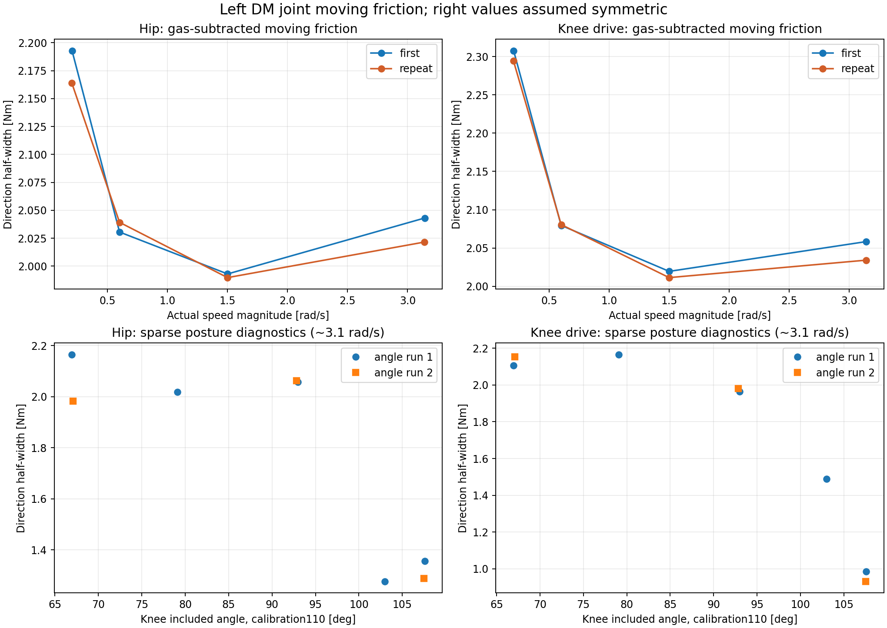

# 四个 DM 电机摩擦辨识（2026-10-31）

使用左腿髋、膝电机同时等角度转动的原始记录，在实际 DM 反馈力矩中减去气簧的电机端保持力矩，再按相同整腿姿态配对正反方向。右腿髋、膝分别采用左腿对应电机的近似值，这是用户授权的对称假设。



## 可获得的数值

下面是两份独立整腿转动记录的等权平均，单位是电机主动输出轴 N·m，不是地面摩擦系数。每个格使用相同的绝对整腿角度区间；两方向的完整分离为表中数值的两倍。

| 实测速度幅值 [rad/s] | hip 运动摩擦力矩 [N·m] | knee 驱动运动摩擦力矩 [N·m] |
|---:|---:|---:|
| 0.203 | 2.178 | 2.301 |
| 0.600 | 2.035 | 2.080 |
| 1.500 | 1.991 | 2.015 |
| 3.142 | 2.032 | 2.046 |

约 0.6–3.1 rad/s 范围，局部简化库仑项候选为左/右 hip **2.020 N·m**、左/右 knee **2.047 N·m**。这是约 84° 历史日志夹角附近的装配状态动摩擦近似，不能无条件覆盖全部夹角、全部速度。低速仍在运动的力矩单独保留，不能叫静摩擦力矩。

`parameters.json` 保存四电机候选、四档速度表和夹角诊断。未知的物理黏性系数、静摩擦脱离阈值、Stribeck 特征速度均为 `null`，没有把缺乏辨识写成物理零。仿真摩擦施加方向为 `-F*sign(v)`，控制前馈补偿方向相反。

## 直接减去气簧之后还要检查什么

使用 `tau_model=-tau_API`、`v_model=-v_API`。已有补偿函数给的是电机为抵住气簧需要施加的保持力矩，所以残差为 `r=tau_feedback_model-tau_gas_holding_model`。不能把 API 力矩直接与 model 力矩相减，不能用闭环命令代替实际反馈。

在水平悬空、无外载条件下，残差仍包含惯性和气簧模型误差。本次排除启动/反向/停机段，并要求实际同向等速、低加速度。再取同一姿态的 `F=(r_positive-r_negative)/2`。`bias=(r_positive+r_negative)/2` 单独保留。它可能混合气簧误差、方向不对称和其他负载，不能唯一归因；对称摩擦模型不能直接把它也算作库仑项。每个角度格的原始反馈、气簧保持力矩、残差、速度、加速度、偏置都见 `paired_cells.csv`。

本批历史数据代入当前补偿后，基准夹角附近 hip 中点范围为 +0.52～+1.01 N·m、knee 为 -2.75～-2.01 N·m；部分大夹角诊断记录中 hip/knee 偏置可分别达到 +8.24/-8.92 N·m。说明“反馈减气簧”还不能直接当成纯摩擦。这里报告的是正反向半差得到的对称有效动摩擦。历史/当前气簧模型替换对基准摩擦半差影响最大 0.0017 N·m，因为同姿态下方向无关的差异基本被配对抵消。这些历史残差不能在缺少编码器零点对应证据时直接证明当前实车补偿误差。

气簧长度不变并不意味着每个电机的气簧力矩为零；两个电机的气簧力矩在共同转动方向上基本抵消。本批处理轨迹的当前模型两电机气簧力矩之和绝对值最大 0.000102 N·m。库仑平台候选之和约 **4.067 N·m**，比两个电机的分别归因更少受内部气簧载荷影响。实际夹角仍有微小波动，单电机结果依赖气簧模型和对称摩擦假设，不能宣称已完全隔离气簧密封摩擦。

## 不同夹角的数据

表中速度均约 3.1 rad/s。历史数据使用旧偏置 `q_model=-q_API+[1.6,2.93]`；当前分支 calibration110 使用 `[1.6,3.0282761689183353]`。分析从原始编码器差值分别重算，保留两种夹角标签，避免把同一编码器姿态误贴成同一个标定角。主要摩擦结果使用当前分支 `full_vehicle_v202.hpp` 与 calibration110 扩展几何，并继承当前气簧力曲线。旧模型作为敏感性对照。

| 历史日志 β [deg] | 当前 calibration110 β [deg] | hip [N·m] | knee 驱动 [N·m] | 有效往返记录数 | 配对姿态格总数 |
|---:|---:|---:|---:|---:|---:|
| 62.67 | 67.02 | 2.074 | 2.131 | 2 | 9 |
| 74.46 | 79.07 | 2.018 | 2.167 | 1 | 5 |
| 88.09 | 92.91 | 2.061 | 1.973 | 2 | 7 |
| 98.08 | 103.00 | 1.276 | 1.489 | 1 | 1 |
| 102.59 | 107.55 | 1.322 | 0.958 | 2 | 2 |

这组记录加减速/抖动较多，严格恒速筛选后每个夹角仅剩少量姿态格，末端部分条件只有 1 格。此表只作夹角依赖诊断，**不作为已经验证的全夹角插值模型**。夹角表表示该装配和气簧预载下的有效运动阻力，包含减速器、轴承、连接件及线束影响。不能进一步唯一分离各个内部部件；也不能用这条共同运动轨迹覆盖相对伸缩方向的全部摩擦。

## 筛选与留出验证

只使用已核对的整腿共同转动阶段。早期两份速度记录对应 waveform 2，后期多夹角记录对应 waveform 4，不能跨版本仅凭枚举值判断动作。要求状态运行、参考激活、左腿、反馈新鲜、反馈年龄 0–5 ms、无故障且无力矩饱和。每阶段 51 点居中均值，速度求导再 101 点均值；剔除 >2 ms 时钟空隙前后 120 ms，每 5 点取一次。滤波仅用于离线分析。

恒速条件：启动后 >0.6 s、距结束 >0.5 s，两个电机同向，速度差 <0.04 rad/s，实际速度距标称值 <max(0.04,5%标称速度)，两电机加速度均 <1 rad/s²。绝对整腿角度每 0.25 rad 一格，两方向各至少 5 个处理样本，格内均值位置差 <0.06 rad、历史 β 差 <0.3°。两份速度记录、全部四速度共用 **16** 个姿态格，格等权，不按慢速记录长度加权。

一份完整速度记录拟合、另一份验证，并交换角色。下面 RMS 评估四档稳态方向半宽，属于不同录制之间的离线验证，不是时域闭环或硬件验证。

| 轴 | 分割 | 库仑常数 RMS [N·m] | 库仑+非负黏性 RMS [N·m] | 实测速度表 RMS [N·m] | 拟合非负 B [N·m·s/rad] |
|---|---|---:|---:|---:|---:|
| hip | train_first_validate_repeat | 0.0671 | 0.0671 | 0.0187 | 7.0226e-13 |
| hip | train_repeat_validate_first | 0.0770 | 0.0770 | 0.0189 | 1.8357e-13 |
| knee | train_first_validate_repeat | 0.1127 | 0.1127 | 0.0144 | 4.9544e-19 |
| knee | train_repeat_validate_first | 0.1132 | 0.1132 | 0.0145 | 3.5978e-20 |

速度按固定顺序执行，没有 DM 电机温度记录。低速动摩擦增加可作为经验速度依赖项保存，但不足以唯一确定静摩擦峰值、Stribeck 特征速度或物理黏性阻尼。小加速度余量与模型误差仍存在；`analysis.json` 包含 0.5/2 rad/s² 筛选敏感性对照。第二次多角度记录在最后一组中途结束，未把单向段作为完整往返。

## 来源与复现

- `/home/noir/Documents/workspace/wheel_leg扫频/左腿整腿转动，覆盖低速和约 2 秒一圈.csv`，SHA-256 `cd6db89bc493d5f0ddfb84ef775c4f9468429e511a7b2cd7dee355d34c5a196c`
- `/home/noir/Documents/workspace/wheel_leg扫频/左腿整腿转动，覆盖低速和约 2 秒一圈（2）.csv`，SHA-256 `8f7e2c78639e917b8d7bb33956d904876598509ad18f9d2d20fe98170c6aff50`
- `/home/noir/Documents/workspace/wheel_leg扫频/左腿关节不同夹角扫频.csv`，SHA-256 `da4a6f2e3286870f2646639dad9f665244a086d829863801cc8ad32b44766597`

原始 CSV 全部 SHA-256 重新匹配，未修改。第一份文件被中断的末行 245805 沿用既有审计排除。`gas_models.json` 保存当次使用的曲线、几何、标定和源文件哈希。数据读取与拟合：

```bash
/home/noir/.cache/codex-runtimes/codex-primary-runtime/dependencies/python/bin/python3 .script/identification/analyze_dm_leg_friction.py prepare --out reports/dm_leg_friction_20261031
/home/noir/miniconda3/envs/isaacsim6/bin/python .script/identification/analyze_dm_leg_friction.py analyze --out reports/dm_leg_friction_20261031
```

仅新增离线分析脚本及报告。没有修改实车控制器或 Isaac Sim 默认模型，没有启动实车或训练。
