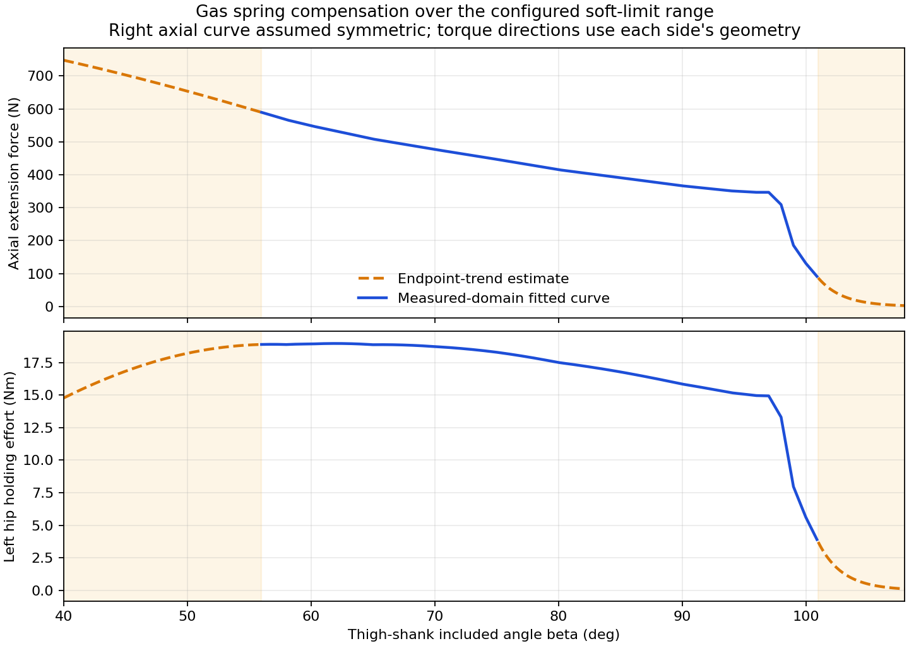

# 气簧输出力矩补偿与同源仿真配置

本包根据已辨识的平均有效气簧力曲线，使用**实际四电机角度**求大小腿夹角、压缩量与力臂，再将保持力矩加入两个腿电机的控制输出。左右腿均启用，右侧轴向力使用用户指定的左侧对称假设，机构雅可比保留各侧自己的符号。

## 覆盖范围及外推

实测拟合范围仍为 **56–101°**，原有16个力曲线节点保持。用户要求的两端补全采用压缩量域的端点趋势：

- 更深压缩端：沿末段斜率线性延长。
- 更小压缩端：`F = F_low exp(k (s-s_low))`，其中 `k = F'_low / F_low`，使连接处的力和一阶斜率连续，并保持正值。
- 这些外推值是估计，尚无独立实测支持；没有把往返摩擦或高速阻尼加入气簧前馈。

机构几何重新求解为39.5–108.5°查表，仅用于覆盖当前代码中两侧完整的主动轴差值软限位 `[-0.140638855, 1.3889088544] rad`，约40–108°。补偿不再在56°和101°退出。原生资产的被动膝上限仍为107°，边界外的几何求解不表示拓宽物理关节限位。

| 大小腿夹角 | 轴向力 N | 左hip保持力矩 Nm，模型坐标 | 来源 |
|---:|---:|---:|---|
| 40° | 747.70 | +14.767 | 趋势外推 |
| 50° | 653.75 | +18.201 | 趋势外推 |
| 56° | 589.49 | +18.882 | 实测域拟合 |
| 75° | 446.86 | +18.284 | 实测域拟合 |
| 98° | 309.43 | +13.300 | 实测域拟合 |
| 101° | 86.97 | +3.709 | 实测域拟合 |
| 104° | 19.21 | +0.811 | 趋势外推 |
| 108° | 2.67 | +0.111 | 趋势外推 |



## 实机和仿真的对应关系

`delta_left = q_left_aux - q_left_hip`，`delta_right = q_right_hip - q_right_aux`；这里使用校准后的主动**模型**坐标，aux是独立膝驱动轴，不是被动膝铰链。

虚功关系为 `tau_hold_model = -(dl/dq)^T F(s)`。RMCS按 `tau_api = J_motor_to_model^T tau_model` 转换一次；当前校准为 `J=-I`，因此左hip在75°的API补偿约为 **-18.284 Nm**，同侧膝驱动约为 **+18.284 Nm**，右侧相反。不要再次应用DM的反向设置。

实机与仿真均按 `PD + 气簧前馈 → 每轴40 Nm限幅 → 软限位向外力矩投影` 执行。软限位保护区内，向外分量仍会被抑制，共同旋转和向内分量保留。前馈诊断记录的是限幅/投影之前的请求量；最终发送力矩应查看原有 `control_torque`。

RMCS的普通及unified RL配置均已启用补偿，增益1。DM内部位置PD模式启用时，补偿路径使用已有的host torque override，避免内部PD丢弃前馈。停机、反馈超时和复位清零补偿输出。新增beta、力、增益和 `extrapolated` 字段写入原有记录器；没有增加周期打印。

仿真 `V5Control` 同时使用本包轴向力作为**真实物理气簧**，并计算相反的电机补偿；不会删除气簧来模拟“补偿”。TGS设置为每次求解迭代施加外力，与原生气簧验证夹具一致。几何查表范围之外物理轴向力保持几何端点值，作为显式数值先验；电机补偿超出查表域则为0。已知软限位完整包含在查表域内。

## 后续训练入口

`scripts/train_scratch_standing.py` 及其upright/prone入口的默认机制改为 [mechanism.json](mechanism.json)。[design.json](design.json) 从原独立父设计保留任务、判据、预算和轮参数，只显式增加气簧力、前馈及同实机的软限位处理；[evidence.json](evidence.json) 绑定模型、控制源码、原生报告和轨迹SHA。

训练仍要求新actor、新critic和空Adam。旧的未补偿静态负载偏置不再默认用于新训练，避免叠加已经补偿的气簧负载；重新使用静态负载初始化需要与本机制匹配的独立标定。本次未启动PPO，未操作实车。所有修改留在当前工作区，未提交。

本机制沿用父配置的轮响应先验；此前新减速箱的独立可选模型仍在 `model/wheel_identified_1562_20261028/`。本包不把腿部补偿验证当作整车real2sim或策略验收。

## 验证

最终原生夹具使用当前V7 USD、两侧真实闭链、固定机身、零重力、无地面接触和无摩擦。42/50/60/75/90/98/104/106.5°共16组补偿开/关对照，1ms运行、每组1.5s，共24000步；仅复位时写初值，物理运行中不写被动关节状态。

四轴稳态位置误差RMS由 **0.085937 rad（4.924°）** 降至 **0.000026377 rad（0.00151°）**，见 [native_final/report.json](../../reports/gas_spring_compensation_20261028/native_final/report.json)。这是同一物理模型下的补偿、坐标与闭链自洽性验证，不能证明外推段真实准确，也不能代替带载实车验证。夹具额外电机armature 0.02 kg·m²只用于数值稳定，不是实测腿惯量。

RMCS构建通过，38项C++测试通过，包括补偿符号、软限位投影、40Nm限幅、反馈超时、复位清零及真实控制器/桥接离线集成。全软限位2001点的C++/Torch补偿一致，峰值约18.957Nm；最终日志和回执位于 `reports/gas_spring_compensation_20261028/`。

196项相关Python测试通过，包含CPU/CUDA一致性、趋势外推连续性、未补偿旧负载偏置拒绝复用和训练入口配置。额外的DM内部位置PD后台测试确认host torque override生效。完整 `ChassisEnv` 以21环境运行20个1ms物理步，确认补偿、物理气簧、软限位和每次求解迭代施加外力实际启用；这只是接线验证，不授予站立或策略能力结论。汇总证据见 [verification.json](../../reports/gas_spring_compensation_20261028/verification.json)。

当前分支底盘模式重构存在缺失的reset/高度接口和yaw成员，构建时已补齐，并保留双DOWN复位后可重新解锁的行为；专门的离线测试覆盖其复位、失联和高度限幅。

## 代码入口

| 用途 | 文件 |
|---|---|
| RMCS公式与冻结数据 | `rmcs_core/src/controller/chassis/wheel_leg/gas_spring_compensation.hpp`、`gas_spring_model.hpp`；`.script/identification/calibration/gas_spring_compensation_20261028.json` |
| RMCS调用、参数、诊断及复位 | 同目录 `action.cpp`、`configuration.cpp`、`wheel_leg_controller.cpp`、`wheel_leg_controller.hpp` |
| RL开关与记录字段 | `rmcs_bringup/config/wheel-leg-infantry-rl.yaml`、`wheel-leg-infantry-unified-rl.yaml` |
| 离线C++验证 | `rmcs_core/test/wheel_leg_gas_spring.cpp`、`wheel_leg_mode.cpp`、`wheel_leg_policy_integration.cpp`；`tools/wheel_leg_gas_spring_parity.cpp`；`CMakeLists.txt`及测试文件的`.gitignore`例外 |
| 本次补齐的现有模式重构 | `rmcs_core/src/controller/chassis/wheel_leg/mode.hpp`、`wheel_leg_chassis_controller.cpp` |
| 仿真控制与物理力 | `src/wheeled_tasks/chassis/gas_spring_compensation.py`、`v5_control.py`、`env.py` |
| 新训练入口和冻结校验 | `scripts/train_scratch_standing.py`、`train_chassis.py`、`evaluate_chassis.py`；`src/wheeled_tasks/chassis/preflight.py` |
| 导出、报告和原生测试 | `tools/export_gas_spring_compensation.py`、`report_gas_spring_compensation.py`；`scripts/probe_gas_spring_compensation.py`、`check_gas_spring_compensation_parity.py` |
| Python回归 | `tests/test_gas_spring_compensation.py`、`test_upright_locomotion.py` |

## 复现

```bash
PYTHONPATH=src /home/noir/miniconda3/envs/isaacsim6/bin/python tools/export_gas_spring_compensation.py
PYTHONPATH=src OMNI_KIT_ACCEPT_EULA=YES /home/noir/miniconda3/envs/isaacsim6/bin/python scripts/probe_gas_spring_compensation.py --output /tmp/gas_compensation_native_new
PYTHONPATH=src /home/noir/miniconda3/envs/isaacsim6/bin/python tools/report_gas_spring_compensation.py
```

导出脚本同时生成RMCS的JSON校准快照与C++常量表；C++遵循仓库clang-format。原有严格域检查的 `IdentifiedGasSpringCurve` 和历史拟合包保留原样。
