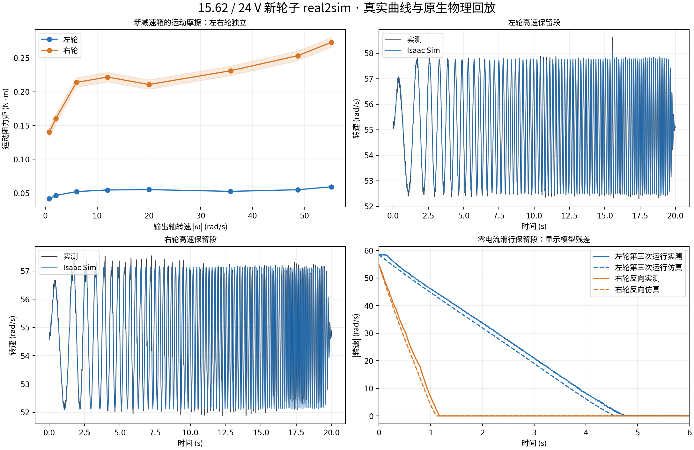

# 新减速箱左右轮 real2sim 模型（2026-10-28）

已分别使用新减速箱 **15.62、24 V** 的低速和高速实测拟合。用户已明确确认两份 CSV 都属于新硬件。参数单位均为**轮输出轴**；没有套用旧 15.8 轮子的辨识结果，也没有再乘一次减速比。

## 可用参数与状态

| 轮子 | 总等效惯量 kg·m² | 额外 armature kg·m² | 20 rad/s 运动阻力 N·m | 55 rad/s 运动阻力 N·m | 有效总延迟 ms | 正/反空载平台 rad/s |
|---|---:|---:|---:|---:|---:|---:|
| 左轮 | 0.0042696 | 0.0036946 | 0.0550 | 0.0590 | 5.5 | 59.28 / 58.80 |
| 右轮 | 0.0043668 | 0.0037918 | 0.2108 | 0.2726 | 3.5 | 57.13 / 56.77 |

总惯量包含 CAD 轮子惯量 **0.000575 kg·m²**；原生物理只添加表中的额外 armature。完整非线性摩擦曲线、方向差异和高速限幅位于 [model.json](model.json)。单一 `b·ω` 无法覆盖当前数据中静摩擦与左右轮的差异，运行时采用分段线性运动阻力曲线。静态起动名义值左 **0.19 N·m**、右 **0.375 N·m**，观测约束范围分别为 **0.15–0.23**、**0.30–0.45 N·m**；这些是有不确定性的起动参数，并非精确的静摩擦常数。

日志中左右轮的驱动器标称电流换算上限均为 **4.880434 N·m**，记录和当前候选的轮子软件限幅为 **4.5 N·m**。40 N·m 属于 DM 腿关节范围，不应套到这些轮子上。复现实验使用输出侧速度 **P=0.5**，无 I/D；这表示记录中的控制器，不表示本次另做了 PID 最优性证明。

## 拟合与验证

先用不含验证标签的有源激励及零电流训练滑行估计有效惯量；用训练力矩探针的频响约束延迟。低速 ≤2 rad/s 的运动阻力来自低速有源数据，≥6 rad/s 来自零电流训练滑行，区间内插值。这样避免长时间闭环保持段吞没被动摩擦信息。高转速的 65 rad/s 目标平台不作为“指令力矩全部有效”的样本。

高频探针以外的验证标签段、后续滑行段，以及高速文件第三次运行不进入参数求解。低速 CSV 的最后一个不完整行已排除；详细来源、SHA256、各段时长和缺口均在 [source_audit.json](../../reports/wheel_real2sim_1562_20261028/source_audit.json)。记录存在约 **38 ms** 的日志缺口，拟合窗口排除大于2 ms的间断；原生回放持有源参考并按1 ms运行，测量插值仅用于评分。

原生 **Isaac Sim 6 / CPU PhysX** 使用当前 V7 USD、固定底座及有限腿支撑关节锁定，保留原闭链。最终验证 **gravity=(0,0,0)**，共 **20000** 步、**273.98** 个轮子仿真秒。每段只注入一次轮速初值；之后不注入实测状态。CAD惯量、额外armature、静/动摩擦均从PhysX读回核对。Native carrier最大漂移 1.79e-06（各关节原生单位）。

| 原生回放段 | 时长 s | 转速 RMSE rad/s | 绝对误差 P95 rad/s |
|---|---:|---:|---:|
| left_high_r2_s12 | 19.999 | 0.138 | 0.264 |
| right_high_r2_s42 | 19.999 | 0.328 | 0.733 |
| left_high_r2_s13 | 19.996 | 0.082 | 0.155 |
| right_high_r2_s43 | 19.994 | 0.108 | 0.193 |
| left_high_r2_s14 | 9.997 | 1.665 | 3.520 |
| right_high_r2_s44 | 10.002 | 1.164 | 3.491 |
| left_high_r2_s27 | 19.997 | 0.139 | 0.210 |
| right_high_r2_s57 | 19.996 | 0.267 | 0.632 |
| left_high_r2_s28 | 19.999 | 0.063 | 0.120 |
| right_high_r2_s58 | 19.999 | 0.098 | 0.186 |
| left_high_r2_s29 | 9.996 | 2.282 | 4.584 |
| right_high_r2_s59 | 9.997 | 0.854 | 2.652 |
| left_low_r1_s131 | 19.999 | 0.169 | 0.289 |
| right_low_r1_s267 | 19.999 | 0.144 | 0.274 |
| left_high_r3_s2 | 7.996 | 0.889 | 1.000 |
| left_high_r3_s3 | 10.002 | 1.209 | 2.115 |
| left_low_r1_s8 | 1.995 | 0.134 | 0.342 |
| right_low_r1_s150 | 2.003 | 0.004 | 0.000 |
| left_low_r1_s14 | 1.999 | 0.170 | 0.315 |
| right_low_r1_s156 | 2.001 | 0.247 | 0.472 |
| left_low_r1_s11 | 2.000 | 0.124 | 0.308 |
| right_low_r1_s153 | 1.995 | 0.002 | 0.000 |
| left_low_r1_s17 | 1.999 | 0.189 | 0.324 |
| right_low_r1_s159 | 1.999 | 0.244 | 0.495 |

滑行误差显著大于闭环跟踪误差，保留其原值；这份候选不能宣称所有工况都已精确复现。低速起动段作为诊断，未称独立盲测；部分慢版动态段原长30秒，原生验证使用前20秒，表中明确给出实际时长。第三次运行的左轮平台受温度/供电变化影响，平台误差亦未删去。



## 在 RL 中使用

已接入 `ChassisEnv` 的可选 `identified_wheel_response` 模块。原生物理处理额外惯量和基础静/动摩擦，组件单独处理余下的速度相关被动阻力、有效延迟和方向相关高速驱动上限；制动维持独立的4.5 N·m软件限幅。被动阻力与电机电流统计分开，旧轮子摩擦/armature被清零，避免重复建模。

本包提供完整可选输入：

- [mechanism.json](mechanism.json)：含新轮子模型的研究训练配置。
- [control.json](control.json)：匹配记录的轮速度P0.5与输出侧4.5 N·m限幅。
- [design.json](design.json)、[evidence.json](evidence.json)：独立父设计的显式轮参数变更及原生证据哈希。
- [静态预检回执](../../reports/wheel_real2sim_1562_20261028/preflight.json)：`static_passed`；未启动PPO，未执行整车该训练配置的原生功能验收。

将现有启动入口的 mechanism/control 输入显式选为本包文件。默认训练入口保持其原配置；本包不会热改正在进行的实验。后续训练应使用新的actor、critic和空Adam。创建其他配置时可调用 `configure_identified_wheels()`，它保留腿参数，并移除历史轮子响应；新的独立设计与证据必须随配置一同更新。

## 仍需区分的物理量

1. **5.5/3.5 ms 是 CAN帧指令到上报RPM的有效总延迟**，不能分别识别电流环、传输和测速滤波。候选将它作为有效输入延迟；如果启用独立USB/反馈延迟模型，必须关闭 `apply_aggregate_delay` 并重新冻结对应证据，避免叠加。
2. 空载最高转速平台是实测的；**高速带载力矩—转速曲线形状未被这些悬空数据充分约束**。名义转矩下降宽度10%是显式先验，可在5–20%内研究随机化，不能说已通过测功机辨识。软件4.5 N·m上限也不是所有速度下都能持续达到的机械输出保证。
3. 转矩来自C620电流的额定换算，非轴端力矩传感器；惯量、摩擦均相对于这个尺度。地面接触/轮胎摩擦、齿隙、弹性、轮胎受载惯性及热模型不由本数据独立确定。
4. 起动静摩擦与低速齿槽/预滑动有混合影响。摩擦曲线在测量区间外保持端值；用于RL时应保留辨识残差与温度变化的参数不确定性。现有独立惯量±6%约定不自动扩大，也不在总惯量与armature上重复叠加随机化。

摩擦项的物理区分可参考 [MathWorks旋转摩擦文档](https://www.mathworks.com/help/simscape/ref/rotationalfriction.html)；本包的参数均取自上述本机新硬件数据，未使用该文档的示例默认值。

## 重复生成

```bash
/home/noir/.cache/codex-runtimes/codex-primary-runtime/dependencies/python/bin/python3 tools/identify_wheel_1562.py prepare
/home/noir/miniconda3/envs/isaacsim6/bin/python tools/identify_wheel_1562.py fit
OMNI_KIT_ACCEPT_EULA=YES /home/noir/miniconda3/envs/isaacsim6/bin/python scripts/replay_wheel_1562_isaac.py --output /tmp/wheel_1562_native_new
```

准备步骤验证原CSV哈希后读取其本机数值缓存。现有 `native`、`native_final` 为本轮早期候选/含重力诊断记录，均保留；**本包最终证据仅绑定 `native_zero_gravity` 与当前模型SHA**。输出目录须为新目录，避免覆盖证据。
