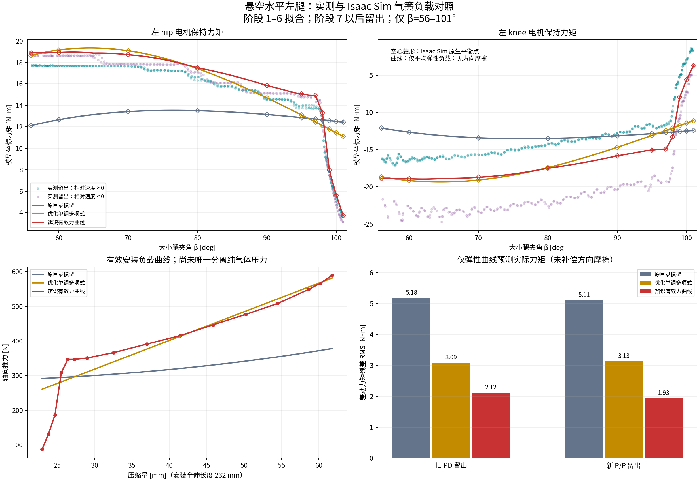

# 左腿气簧 Real2Sim 标定（2026-10-27）

已完成真实力矩曲线拟合与 Isaac Sim 6 / PhysX 原生闭链验证。新 P/P 留出数据上，仅弹性负载模型的差动力矩残差 RMS 从 **5.114 降到 1.935 N·m，降低 62.2%**。这是更贴近本次实测的左腿有效安装负载模型，尚不能称为已唯一辨识的纯气体压力模型。



## 数据与拟合边界

用户确认水平完全悬空，无重力和外部负载。数据为 DM 上报力矩，未使用独立力传感器。两个原始 CSV 的 SHA-256 和逐文件来源见 [real_data.json](real_data.json)，已在最终导出时重新核验。旧文件 218309 条有效记录、末尾损坏行 218311 被排除；新文件 112144 条记录。共导出 4326 个预处理点，筛选后 2618 点。

只取慢扫：旧记录阶段 1–12、新记录 1–11，新记录不完整阶段 12 不用；每份数据的阶段 1–6 拟合，后续阶段留出。留出旧/新分别 619/610 点。先进行 51 点均值平滑和 101 点相对加速度平滑，避开 >2 ms 数据间隔前后 120 ms，再约每 20 ms 取点；筛选 |相对角速度|>0.06 rad/s、|相对角加速度|<3 rad/s²、|hip 角速度|<0.18 rad/s。训练时按往返周期、0.5° 角度、方向与来源分组等权，防止停滞点支配曲线。预处理源码哈希有记录。

仅覆盖 **左腿实际 β=56–101°、压缩量 22.997–61.786 mm**。未外推至机械全行程，未辨识右腿。当前 β 标定和 CAD 安装尺寸作为固定条件。

## 物理映射

采用当前 V6 `纯底盘_v6_232mm_stop105/urdf`，19 个刚体、18 个树关节、6 个球形闭链约束。左侧两个实际电机为 `L_joint1` 和 `LL_joint1`；`L_joint2` 是被动膝铰链，不能把它的反力当作 DM knee 力矩。V6 两电机相对角与 RMCS 角度表一致。

安装全伸销距 232 mm，行程 80 mm；压缩量 s=0.06972718009112547−q_slide。沿闭链求 J=∂l/∂[q_hip,q_knee]。气簧驱动力矩为 JᵀF，静态电机补偿为 **−JᵀF**。左腿仿真模型坐标是 [+T,−T]，RMCS 电机 API 坐标相反。方向必须在接入实车时按当前标定核对。

拟合标量 T=(τ_hip−τ_knee)/2。平均负载和方向相关的半宽 W(β) 同时估计，T_pred=T_spring(β)−W(β)sign(dq_knee−dq_hip)。W 只作为摩擦/密封滞回等的诊断项，**没有作为气簧轴向力导出**。两电机共同分量不能由一个轴向弹簧力解释，保留为残差。

## 留出验证（N·m）

| 模型 | 旧记录差动 RMS，仅弹性 | 新记录差动 RMS，仅弹性 | 新记录差动 RMS，另含方向项 | 新记录两个电机合并 RMS，仅弹性 |
|---|---:|---:|---:|---:|
| 原目录气簧 | 5.183 | 5.114 | 5.014 | 5.374 |
| 优化单调多项式 | 3.089 | 3.133 | 2.536 | 3.541 |
| 辨识有效力曲线 | 2.115 | 1.935 | 0.426 | 2.544 |

“仅弹性”残差仍包含未补偿方向摩擦；0.426 N·m 需要额外方向项，不能当成气簧模型单独误差。两个电机合并 RMS 是 hip/knee 残差的均方合并。留出来自同一批实验后续往返，能够检验重复性，尚非第三次独立采集或高速验证。

原模型 F=280+122.735918491(s/0.08)²+53.969804409(s/0.08)³ N。非负系数的普通单调多项式也做了优化，其误差仍明显高于有效查表曲线，因此不能只把原气簧乘一个常数。

## 原生 Isaac Sim 验证

以下均在真实 Isaac Sim 6.0.0.1、Isaac Lab 6.1.14 / PhysX 中运行，无地面接触、固定基座、重力为零。物理步长 1 ms，求解器 64/32 次迭代；显式电机 PD=160/2.5，限幅 40 N·m。所有工况均达到静态判据。

| 原生记录 | 工况数 | 电机力矩与 −JᵀF 的 RMS [N·m] | 最大闭链间隙 [mm] | 最大末段速度 RMS [rad/s] |
|---|---:|---:|---:|---:|
| native_unit.json | 6 | 0.000058 | 0.0028 | 0.000456 |
| native_curves.json | 24 | 0.001494 | 0.0231 | 0.000990 |
| native_edge.json | 9 | 0.000385 | 0.0099 | 0.000607 |

6 个单位力工况使用 0/100 N 轴向力、无气簧前馈，自由达到平衡；用最终实际角度得到力到电机力矩的映射校准，比例约为 1.00000263/0.99999744。另外 33 个工况验证原模型、多项式和有效查表，包含 99/100/101° 末端。曲线工况使用固定位置参考预偏置让实际平衡角接近采样角；预偏置仅初始化一次，没有在线力矩前馈，也没有物理运行中覆写被动关节位置。这些工况验证载荷传递和数值平衡，不能替代独立传感器测力。

测量夹具对电机使用 0.02 kg·m² 数值 armature 以稳定显式控制，不代表已辨识真实惯量，没有写入生产惯量。零 armature 的两次不稳定尝试保留为 `native_unit_failed_*`，没有作为有效校准。闭链关节 incoming/projected force 包括约束反力，未当作纯气簧力矩使用。

数值端点允许最多 20 μm 的显式 endpoint hold，严格超域计数和实际超出量逐工况保存在 [validation_receipt.json](validation_receipt.json)。101° 附近的微小数值超域用端点力保持；导出的公共组件本身严格拒绝超域。初始 6/24 工况对应源码哈希记录在各 JSON；补充末端工况另保存了 `native_edge.source.py`，不会把后来修改的源码冒称为旧运行版本。

## 导出与使用

独立模型：`/home/noir/Documents/workspace/isaac_wheeled_rl_train/model/gas_spring_identified_left_20261027/model.json`。Torch 组件：`src/wheeled_tasks/chassis/identified_gas_spring.py`。查表保持正力、随压缩量非减，势能为同一分段线性力的精确积分，已核验 dU/ds=F；没有额外启用摩擦项。加载示例：

```python
from wheeled_tasks.chassis.identified_gas_spring import IdentifiedGasSpringCurve
curve = IdentifiedGasSpringCurve.from_json("model/gas_spring_identified_left_20261027/model.json")
force_n = curve.force(compression_m)  # positive outward along the spring slide
```

原生末端验证实际调用了这个 Torch 组件。模型不静默外推，右腿不可直接宣称已标定。当前默认训练气簧、生产合同和控制器未替换，未启动 PPO，未运行实车补偿闭环。

| 压缩量 [mm] | 有效轴向力 [N] |
|---:|---:|
| 22.997 | 86.97 |
| 23.852 | 131.18 |
| 24.710 | 185.68 |
| 25.573 | 309.43 |
| 26.438 | 346.74 |
| 27.307 | 346.74 |
| 29.054 | 350.90 |
| 32.578 | 366.39 |
| 37.017 | 391.10 |
| 41.466 | 415.32 |
| 45.888 | 446.86 |
| 50.248 | 476.85 |
| 54.507 | 508.42 |
| 58.624 | 548.70 |
| 60.221 | 567.00 |
| 61.786 | 589.49 |

## 物理解读与尚未分离的因素

98–101° 处的有效力明显下降，特别是压缩约 23–26 mm 的段落；它能复现本批力矩，却不符合简单目录压力曲线的平缓形状。不能据此反推一个可信的单一气压。它可能还包含安装/角度标定、密封摩擦和滞回、两电机上报力矩偏差或未建模约束的影响。当前将其标记为 **effective mounted force**，`physical_pressure_identified=false`，不把摩擦写成可逆气体力。

阻尼、惯量、控制延迟需要另用高速数据在此平均载荷基础上辨识，本次静态模型不证明这些量已标定，也不证明实车加前馈后的跟踪改善。用于 RL 时可先作为该角域内的左腿候选；完整双腿训练需要右腿/其余角域验证和合同显式接入。

## 复现

先按 `scripts/export_real_gas_spring_data.py --help` 导出原始数据；Isaac 解释器为 `/home/noir/miniconda3/envs/isaacsim6/bin/python`。

```bash
python tools/identify_gas_spring.py geometry --out reports/gas_spring_real2sim_20261027
OMNI_KIT_ACCEPT_EULA=YES python scripts/probe_identified_gas_spring.py --data reports/gas_spring_real2sim_20261027 --mode unit --output reports/gas_spring_real2sim_20261027/native_unit.json
python tools/identify_gas_spring.py fit --out reports/gas_spring_real2sim_20261027 --native-probe reports/gas_spring_real2sim_20261027/native_unit.json
OMNI_KIT_ACCEPT_EULA=YES python scripts/probe_identified_gas_spring.py --data reports/gas_spring_real2sim_20261027 --mode curves --output reports/gas_spring_real2sim_20261027/native_curves.json
OMNI_KIT_ACCEPT_EULA=YES python scripts/probe_identified_gas_spring.py --data reports/gas_spring_real2sim_20261027 --mode curves --betas 99 100 101 --output reports/gas_spring_real2sim_20261027/native_edge.json
python scripts/report_identified_gas_spring.py --data reports/gas_spring_real2sim_20261027 --export-dir model/gas_spring_identified_left_20261027
python -m pytest -q tests/test_identified_gas_spring.py tests/test_gas_spring.py
```

以上命令会写同名结果；现有原始运行与失败证据应保留，复现建议用新的输出目录。全部输入、资产、脚本和导出模型 SHA-256 见回执。
