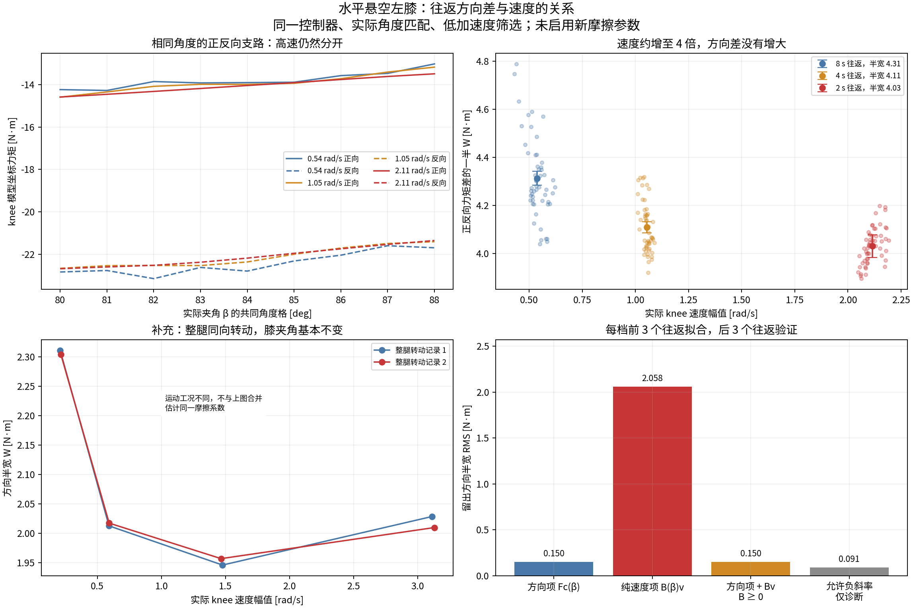

# knee 快速运动往返差与摩擦/阻尼（2026-10-28）

快速运动仍有方向差，但本批数据中方向差没有随速度增大。实际 knee 速度由约 0.54 提高至 2.11 rad/s 时，同角度正反向力矩差约 8.62→8.06 N·m。它不支持“只要快速仍有往返差，就说明主要是黏性阻尼”。

## 同一膝关节的三档速度对照

主证据来自 `wheel_leg_膝关节气簧辨识数据.csv`，run 1 / mode 2。stage 1–12、13–24、25–36 分别为 8/4/2 s 一次往返，每档 6 个完整往返。它是原单环 PD=120/4 的记录；新级联 P/P 文件只有慢扫，不能把本次快速结论宣称为新控制器已经完成高速验证。统一使用实际反馈速度、实际 β 和 DM 报告力矩；模型坐标 τ=−τ_API。没有使用命令力矩替代反馈。

沿用已审计的 51 点居中平滑、速度导数再 101 点平滑，排除 >2 ms 时钟间隔前后 120 ms，排除饱和及无效 β，每 5 个有效样本取点。主比较限制 |vk|>0.1 rad/s、|vh|<0.3 rad/s、|ak|/|ah|<3 rad/s²。按 1° 角度格和单个往返分别配对两个方向；只保留三档速度、全部 6 个往返都有配对的共同角度格 **80–88°**。这些是格中心，格宽 1°。每个往返、角度和速度等权，避免低速采样多造成偏置。

W=(τk,正向−τk,反向)/2，完整方向分离为 2W。W 是持续运动中的方向相关有效负载，不是已独立测得的静摩擦力矩。

| 一次往返 [s] | 平均实际速度幅值 [rad/s] | 方向半宽 W [N·m] | 正反向支路差 2W [N·m] | 两方向位置跟踪误差之差 [deg] |
|---:|---:|---:|---:|---:|
| 8 | 0.537 | 4.312 | 8.625 | 4.075 |
| 4 | 1.053 | 4.108 | 8.217 | 3.707 |
| 2 | 2.114 | 4.030 | 8.061 | 3.433 |

位置误差取日志 `tracking_error`，同样按实际 β 配对；其方向差不是绝对跟踪误差或整段 RMS。位置方向差随速度也未增大。不能仅用位置闭环误差识别阻尼，因为 D 项、参考速度和控制延迟也会影响它。

## 留出比较与干扰检查

各档前 3 个往返拟合、后 3 个往返验证。位置依赖项均在相同角度格估计。比较 W=Fc(β)、W=B(β)|v|、W=Fc(β)+B|v| 且 B≥0。另允许 B 为负，仅用来描述速度减弱趋势，不作为物理阻尼。

| 方向半宽模型 | 留出 RMS [N·m] |
|---|---:|
| coulomb | 0.1501 |
| viscous_only | 2.0576 |
| coulomb_plus_nonnegative_viscous | 0.1501 |
| signed_speed_diagnostic | 0.0907 |

非负黏性项拟合 B=1.08965e-21 N·m/(rad/s)，没有带来有效提升。无约束描述斜率为 -0.165 N·m/(rad/s)。以整个往返为块的 600 次重采样条件区间为 [-0.189, -0.137]。这只表示本次实验顺序下的重复性；速度档按固定顺序执行，没有随机交错或温度记录，不能把负斜率称为负物理阻尼。

将加速度筛选放宽至 6/12 rad/s²、在配对回归中额外加入加速度半差及小角度错配，斜率仍为负；逐项见 `analysis.json`。同角度反向配对有助于消除保守负载和相近惯性，但不是把一切动态力矩完全消掉。

两份整腿转动记录是补充验证：膝夹角约 84°、两个电机同向，实际 knee 速度约 0.2/0.6/1.5/3.1 rad/s。持续运动方向半宽约 2 N·m，高速仍在，随速度并未明显增大。多夹角整腿记录也保存在 JSON 附表。工况不同，不合并成同一个摩擦参数。

## 如何解释

标准摩擦模型中，库仑动摩擦在非零速度下仍可保留近似固定方向力矩，黏性阻尼才表现为力矩随速度增加，静摩擦/脱离静止主要看零速附近的起动过程。低速 Stribeck 效应、密封滞回或温升可能造成当前的弱速度减小趋势；现有记录不能唯一分开它们。模型区别见 [MathWorks Rotational Friction 官方说明](https://www.mathworks.com/help/simscape/ref/rotationalfriction.html)。

因此，当前证据更支持把主要往返差先视作运动方向相关摩擦/滞回负载。不能把约 8 N·m 的全部正反差写成黏性阻尼。也不能宣称阻尼严格为零：正阻尼可能与速度减弱摩擦、温度和闭环测量影响相互抵消。阻尼、纯静摩擦、密封摩擦和轴承/传动摩擦尚未独立识别。

这次只做离线分析，没有修改控制器或 Isaac Sim 的默认气簧/摩擦模型，没有启动实车或训练。

## 来源与复现

原始 CSV 未修改，读取的数值缓存均重新匹配原文件 SHA-256；中断末行处理沿用各缓存审计。来源：

- `/home/noir/Documents/workspace/wheel_leg扫频/wheel_leg_膝关节气簧辨识数据.csv`，SHA-256 `17d8ebf42472573a28a85352df0584b964ec4ecc183d4b26e29d5f4c729dc0ba`
- `/home/noir/Documents/workspace/wheel_leg扫频/左腿整腿转动，覆盖低速和约 2 秒一圈.csv`，SHA-256 `cd6db89bc493d5f0ddfb84ef775c4f9468429e511a7b2cd7dee355d34c5a196c`
- `/home/noir/Documents/workspace/wheel_leg扫频/左腿整腿转动，覆盖低速和约 2 秒一圈（2）.csv`，SHA-256 `8f7e2c78639e917b8d7bb33956d904876598509ad18f9d2d20fe98170c6aff50`
- `/home/noir/Documents/workspace/wheel_leg扫频/左腿关节不同夹角扫频.csv`，SHA-256 `da4a6f2e3286870f2646639dad9f665244a086d829863801cc8ad32b44766597`

先用带 Pandas 的分析环境运行 `tools/analyze_knee_friction_speed.py prepare --out reports/knee_friction_speed_20261028`，再用 Isaac/scientific Python 运行同脚本的 `analyze` 阶段。`sources.json` 保存原始来源与预处理，`paired_cells.npz` 保存共同角度配对，`analysis.json` 保存全部指标和限制。居中滤波只用于离线分析。
