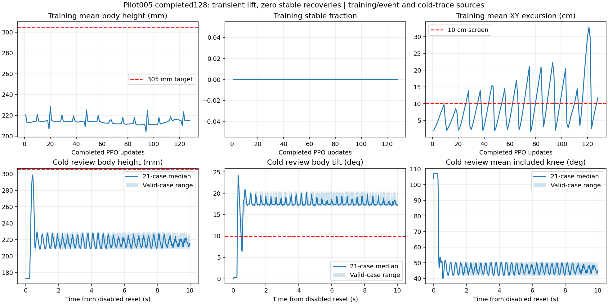

# 标准趴地训练检查与重开

记录时间：2026-10-27T20:57:55.925919+08:00

pilot005已经完成128次更新并自然退出。本次没有中断正在工作的旧进程，也没有续训。已封存最终模型及完整状态，按用户授权修改后从零开始pilot006。

| pilot005指标 | 结果 |
| --- | --- |
| 起立完成 / 站立基线 | 0/21 / 0/21 |
| 短暂最高高度 | 300.32mm，约0.42s |
| 1s后有效样本高度 / 倾角中位数 | 216.34mm / 17.41° |
| 各场最大XY偏移 | 42.59–50.12cm |
| 终止 / 10s超时 | 13 / 8 |

出现了短暂抬升，但随后回落，膝角仍维持40–50°，没有持续站稳的行为证据。训练128个event点稳定比例均0，平均高度没有持续提高，后期偏移变大。该结论不由loss或reward代替。

图上排仅从原TensorBoard event读取，下排从原始冷测trace读取；不是不同代策略拼接验收。图中周期性回落包含episode reset，population均值不作全程峰值。

## 这次修改

- 轮心接近质心下方后，连续衰减保持收腿的奖励，让伸腿无需等待车体先达到305mm；没有定时轨迹或电机接管。
- 增加305mm高度误差和车身水平误差平方成本。5°只是连续水平代价尺度，原10°硬筛查线保持。
- 增加实际起立完成前的1/s耗时成本，连续1s确认完成后停止收取；保留10s工程冷测截止、完成后30s站立。
- 初始腿动作标准差0.3、轮0.2；仍在原Gaussian范围内，全部机械、力矩、速度、闭链和冲击保护不改。
- 固定原趴地起点、原共转可训练bias、v2 requested0.25、256环境、128次上限。seed261004，全新actor/critic/空Adam，旧模型读取0。

同一条旧冷测轨迹上，保持收腿奖励中位值从1.279/s降到0.078/s，同时新增约-3.118/s水平误差和-1.805/s高度误差成本。这是目标函数检查，不是单变量因果证明，也不是新策略效果。

## 新轮实况：training，6/128

冻结源码：`2058fee2e72ccd82143b44fa1a56e52db5469e6c`。275个训练源与提交及原生探针匹配。首个PPO更新12次Adam调用有限，六个输出均更新，训练checkpoint读取0；旧代128次消费保留，不退款。

82项选定CPU测试通过；一个与本任务无关的旧恢复metadata测试缺历史模型fixture，失败记录保留，未为运行它引入旧策略。16项原生检查确认新奖励实际付款，0PPO、0终止；这些仅授予接线准入，不授予行为资格。

新轮尚无起立成功冷测结论。训练器达到128次上限后自行保存final模型并运行固定冷测；不会读取checkpoint续训。

[实时回执](receipt.json) · [旧轮完整性封存](pilot005_completion_integrity001.json) · [旧轮行为结果](pilot005_final_behavior_summary001.json) · [新轮首更新六轴检查](pilot006_six_axis_audit001.json) · [奖励对照](pilot006_reward_counterfactual001.json)

## 长期能力逐项状态

| 能力 | 本代状态 |
| --- | --- |
| 初始多姿态自起 | 未验收通过 |
| 运动跌倒恢复并续接命令 | 未验收通过 |
| 静止站立 | 未验收通过 |
| 低速正反直线 | 未验收通过 |
| 高速正反直线 | 未验收通过 |
| 正反原地自旋 | 未验收通过 |
| 四方向圆弧 | 未验收通过 |
| 静止变高 | 未验收通过 |
| 运动变高 | 未验收通过 |
| 自旋变高 | 未验收通过 |
| 高速急停 | 未验收通过 |
| 动作平顺性 | 未验收通过 |
| 域随机化鲁棒性 | 未验收通过 |

所有最终能力仍须同一冻结策略/控制器束实际验收；起立后的接地从实际完成事件开始，单次连续≤2ms失载按v2规则处理。名义、域随机化和实车证据分开，本次没有实车操作。
